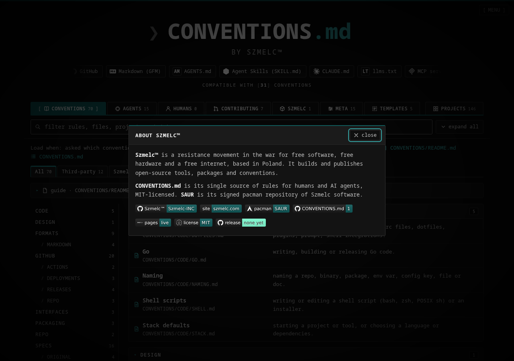
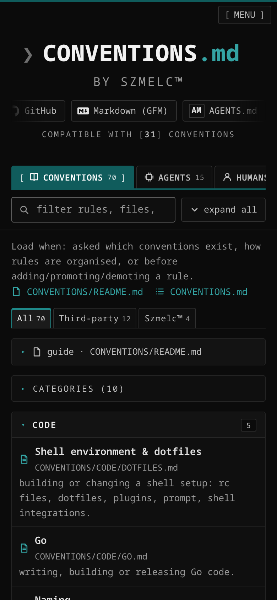

<div align="center">

# CONVENTIONS.md

**One set of rules for humans and AI agents, built into every format that agent tools read.**

```sh
git clone https://github.com/Szmelc-INC/CONVENTIONS.md ~/.config/szmelc/conventions && ~/.config/szmelc/conventions/install.sh
```

[](https://github.com/Szmelc-INC/CONVENTIONS.md/actions/workflows/check.yml)
[](https://github.com/Szmelc-INC/CONVENTIONS.md/releases/latest)
[](LICENSE)
[](https://szmelc-inc.github.io/CONVENTIONS.md/)

<a href="https://szmelc-inc.github.io/CONVENTIONS.md/"></a>

<sub>Live site: <a href="https://szmelc-inc.github.io/CONVENTIONS.md/">szmelc-inc.github.io/CONVENTIONS.md</a> · made by <a href="https://github.com/Szmelc-INC">Szmelc™</a></sub>

</div>

<details>
<summary><b>More screenshots</b> (click to expand)</summary>
<br>
<table>
<tr>
<td align="center" width="50%"><br><sub>[MENU]</sub></td>
<td align="center" width="50%"><br><sub>Projects</sub></td>
</tr>
<tr>
<td align="center"><br><sub>About popup</sub></td>
<td align="center"><br><sub>Phone</sub></td>
</tr>
</table>
</details>

## What it is
CONVENTIONS.md is one source of rules for code, repos, docs and AI agents.
A build script turns these rules into the formats that agent tools read: an Agent Skill, `AGENTS.md`, `CLAUDE.md`, `GEMINI.md`, and Cursor, Copilot and Kiro rules.
It also makes `llms.txt`, a JSON index and a bundle in one file.

Agents read [`INDEX.md`](INDEX.md) one time.
Then they load only the rule files that match the task.
This keeps the token cost low.

## Usage
### Install
```sh
git clone https://github.com/Szmelc-INC/CONVENTIONS.md ~/.config/szmelc/conventions
~/.config/szmelc/conventions/install.sh
```
The installer finds the agent tools on your machine.
It links the global rules into each tool.
For the list of tools, the flags and the setup for one project, read [`HUMANS/README.md`](HUMANS/README.md).

### Update
```sh
git -C ~/.config/szmelc/conventions pull
```
To pin a release, run `git -C ~/.config/szmelc/conventions checkout v2.0.0`.
After a major release, run `install.sh` again.

### Browse
Open the [live site](https://szmelc-inc.github.io/CONVENTIONS.md/).
- Each core has a tab. Each rule opens in place. You can copy a rule as Markdown or as a raw URL.
- The Projects tab shows all public Szmelc™ projects and the third-party projects that the rules use.
- `[MENU]` has install, star, share, theme and more.
- Press `?` on the site to see all keys.

## Compatible with
The rules work with 31 third-party formats, specs and tools.
Some examples are AGENTS.md, Agent Skills, `llms.txt`, MCP, Conventional Commits, SemVer, Nix flakes and Shields.io.

The full list is in [`COMPATIBILITY.md`](COMPATIBILITY.md).
The build makes that file from [`META/compat/registry.toml`](META/compat/registry.toml).
To add an entry, edit the registry and run `META/tools/build.sh`.

<sub>Names and logos belong to their owners. Szmelc™ is not affiliated with them.</sub>

## How it works
### Cores
Seven top-level categories. Each is a directory `X/` with a full guide `X/README.md`, mapped by a root file `X.md`.

| Map | Directory | What |
|---|---|---|
| [`CONVENTIONS.md`](CONVENTIONS.md) | [`CONVENTIONS/`](CONVENTIONS/README.md) | The rules: workflow, GitHub, specs, repo, design, interfaces, packaging, code; experimental proposals and legacy archive |
| [`AGENTS.md`](AGENTS.md) | [`AGENTS/`](AGENTS/README.md) | Always-on global rules, agent behaviour rules, prompt engineering, skills, tool adapters |
| [`HUMANS.md`](HUMANS.md) | [`HUMANS/`](HUMANS/README.md) | Install, browse |
| [`CONTRIBUTING.md`](CONTRIBUTING.md) | [`CONTRIBUTING/`](CONTRIBUTING/README.md) | Extend, write, name, version and ship conventions |
| [`SZMELC.md`](SZMELC.md) | [`SZMELC/`](SZMELC/README.md) | Public organisations, sites, principles, projects index sources |
| [`META.md`](META.md) | [`META/`](META/README.md) | Build/check tools, site generator, schema, compatibility registry, screenshots |
| [`TEMPLATES.md`](TEMPLATES.md) | [`TEMPLATES/`](TEMPLATES/README.md) | Skeletons for rules, prompts, skills, category READMEs, project `AGENTS.md` |

### Layout
```
SKILL.md            meta skill: entry point + format map (installed as skill `szmelc-conventions`)
INDEX.md            map: every file + when to load it (agents read only this first)   [generated]
index.json          same, machine-readable (META/schema/index.schema.json)             [generated]
llms.txt            llmstxt.org index                                                   [generated]
CONVENTIONS.md      map of CONVENTIONS/ + every stable rule in one file                 [generated]
AGENTS.md           instructions for agents in this repo + map of AGENTS/               [map block generated]
HUMANS.md CONTRIBUTING.md SZMELC.md META.md TEMPLATES.md   core maps                    [generated]
COMPATIBILITY.md    compatible third-party formats, specs and tools (META/compat/)     [generated]
CLAUDE.md GEMINI.md import AGENTS.md for agents working on this repo
CONVENTIONS/        rules by UPPERCASE category; EXPERIMENTAL/ proposals, LEGACY/ archive
AGENTS/             global/AGENTS.md, RULES/, PROMPT/, skills/, adapters/ [generated]
HUMANS/             human guide
CONTRIBUTING/       how to extend the conventions (root CONTRIBUTING.md = its map; GitHub shows it on issues/PRs)
SZMELC/             organisation guide, sources.conf (projects index)
META/               tools/, schema/, compat/ (compatibility registry + icons), assets/screenshots/
TEMPLATES/          skeletons (rule, prompt, skill, category README, project AGENTS.md)
install.sh          harness installer
CHANGELOG.md        release history (Keep a Changelog)
LICENSE             MIT
.github/            workflows, issue forms, PR template, release notes config, labels.tsv, SECURITY.md
claude/             compatibility symlinks for pre-1.0 install paths
public/             generated site (GitHub Pages); built in CI, never committed         [generated]
```

### Automation
- CI (`.github/workflows/check.yml`): `META/tools/check.sh`, ShellCheck, `META/tools/test-install.sh`, and the branch-prefix scope check `META/tools/lane-check.sh`.
- Pages (`.github/workflows/pages.yml`): builds and deploys the site on pushes to `main` that touch its sources and nightly at 03:00 UTC to refresh the Projects index.
- Keepalive (job `keepalive` in `pages.yml`): after ~45 quiet days re-enables `pages.yml` via the API so the nightly refresh stays scheduled; never pushes. Nothing bypasses the `main` ruleset (`META/tools/github-setup.sh`). Disabled anyway: `gh workflow enable pages.yml`.
- Dependabot: weekly grouped GitHub Actions updates as normal PRs (`.github/dependabot.yml`).
- Releases: pushing a `vX.Y.Z` tag runs `.github/workflows/release.yml` → `META/tools/release.sh` (`CHANGELOG.md`, `CONTRIBUTING/VERSIONING.md`).

## Contributing
Guide: [`CONTRIBUTING/README.md`](CONTRIBUTING/README.md).

### Branches
`main` is the only long-lived branch; no direct commits. Every change is a short-lived `feat/*`, `fix/*`, `docs/*`, `chore/*`, `experimental/*` or `legacy/*` branch, PR'd into `main`, merged with `gh pr merge --rebase --delete-branch`, then `git checkout main && git pull --ff-only`. Every commit on the branch lands on `main`, so each must be clean and conventional. Details: [`CONVENTIONS/WORKFLOW/BRANCHES.md`](CONVENTIONS/WORKFLOW/BRANCHES.md).

### Rules of this repo
1. One topic = one file. One rule = one line.
2. Every rule file and core `README.md` starts with `# Title` and `> Load when: <trigger>`.
3. Never duplicate a rule; reference it by path (`CONVENTIONS/DESIGN/COLORS.md`).
4. Never edit generated files. Run `META/tools/build.sh`, then `META/tools/check.sh` (CI runs both).
5. New domain → new UPPERCASE directory in a core. New topic → copy `TEMPLATES/rule.md`; format and naming in `CONVENTIONS/SPECS/ORIGINAL/RULE-FILES.md`. New core → directory + `README.md`, then add it to `CORES` in `META/tools/build.sh`, `META/tools/check.sh` and `META/tools/site.sh`.
6. Agents load rules lazily: `INDEX.md` once, then only matching files. Never `@import` rule files into global instructions; that loads every rule every session.
7. Public repo: only already-public material (public repos, orgs, sites).

## License
[MIT](LICENSE)
