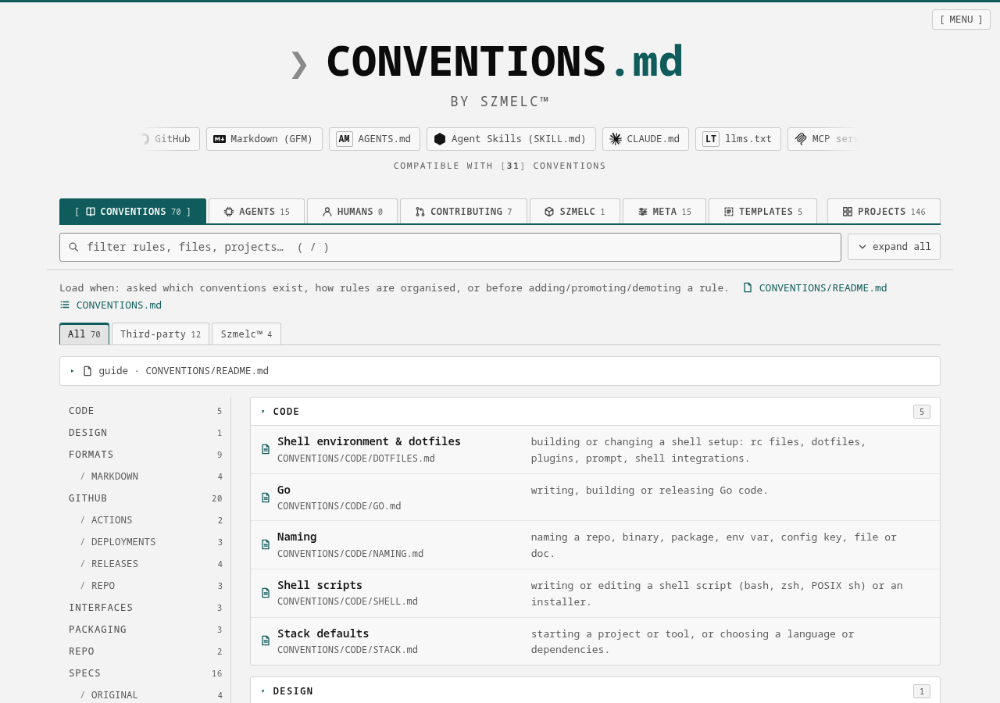

# CONVENTIONS.md
**Global Szmelc™ conventions for humans and AI agents: one source of rules, built into every format an agent harness reads.**

```sh
git clone https://github.com/Szmelc-INC/CONVENTIONS.md ~/.config/szmelc/conventions && ~/.config/szmelc/conventions/install.sh
```

[](https://github.com/Szmelc-INC/CONVENTIONS.md/actions/workflows/check.yml)
[](https://github.com/Szmelc-INC/CONVENTIONS.md/actions/workflows/pages.yml)
[](https://github.com/Szmelc-INC/CONVENTIONS.md/releases/latest)
[](https://github.com/Szmelc-INC/CONVENTIONS.md)
[](LICENSE)
[](https://szmelc-inc.github.io/CONVENTIONS.md/)
[](SKILL.md)
[](AGENTS/global/AGENTS.md)

> Global conventions for everything, for humans and AI agents. One source, every format: an Agent Skill, `AGENTS.md`/`CLAUDE.md`/`GEMINI.md`, Cursor, Copilot and Kiro rules, plus `llms.txt`, a JSON index and a single-file bundle.
> All rules, instructions, templates, formats and agreed-upon schemes in one place, to make them as universal, deterministic, logical and parseable as possible.
>
> Same idea, but much more ***meta***™: one convention to rule them all. The same logic everywhere, from the root map `SZMELC.md` down to its guide `SZMELC/README.md` and every category below it.

## Screenshots
Live site: <https://szmelc-inc.github.io/CONVENTIONS.md/>. Rebuilt with `META/tools/screenshots.sh` ([how](META/assets/screenshots/README.md)).

| | |
|---|---|
| [](META/assets/screenshots/hero-dark.png) | [![The [MENU] dropdown open: install, star, contribute, links, share, theme and keys](META/assets/screenshots/menu.png)](META/assets/screenshots/menu.png) |
| Home, dark theme | `[MENU]` |
| [](META/assets/screenshots/projects.png) | [](META/assets/screenshots/popup-about.png) |
| Projects: Szmelc™ and third-party | About popup (`#about`) |
| [](META/assets/screenshots/light.png) | [](META/assets/screenshots/mobile.png) |
| Light theme | Mobile |

## Usage
### Install
```sh
git clone https://github.com/Szmelc-INC/CONVENTIONS.md ~/.config/szmelc/conventions
~/.config/szmelc/conventions/install.sh
```
Harness table, flags and per-project setup: [`HUMANS/README.md`](HUMANS/README.md). Agents read [`INDEX.md`](INDEX.md) once, then load only the rule files that match the task.

### Live site
[szmelc-inc.github.io/CONVENTIONS.md](https://szmelc-inc.github.io/CONVENTIONS.md/), built by [`META/tools/site.sh`](META/tools/site.sh) and deployed to GitHub Pages nightly and on pushes to `main` that change its sources.
- Tabs: one per core with its guide and nested category groups; every rule readable inline, copyable as Markdown or a raw URL.
- Projects tab: public Szmelc™ repositories from the GitHub API (owners in [`SZMELC/sources.conf`](SZMELC/sources.conf)) and the third-party projects from the compatibility registry, with `All · Third-party · Szmelc™` sub-tabs; experimental proposals and the legacy archive.
- "Compatible with" carousel under the title; click an entry for its popup, or `Compatible with [N] conventions` for the full list.
- `[MENU]`: install, star count, contribute, issues, GitHub, releases, discussions, About Szmelc™, share, theme, keys.
- Themes: dark (default), light, mono, terminal; saved per browser, `?theme=<name>` overrides.
- Keys: `/` filter, `1`–`9` and `0` tabs, `e` expand all, `t` theme, `?` keys list, `esc` close or clear.
- Deep links: `#<core>`, `#<core>/<category>/`, `#<path>`, `#projects`, and popups `#install`, `#about`, `#compat`, `#compat/<id>`.

## Compatible with
31 third-party formats, specs, platforms, languages and tools (AGENTS.md, Agent Skills, CLAUDE.md, llms.txt, MCP, Keep a Changelog, SemVer, Shields.io and more): [`COMPATIBILITY.md`](COMPATIBILITY.md), generated from [`META/compat/registry.toml`](META/compat/registry.toml). Names and logos are trademarks of their respective owners; Szmelc™ is not affiliated with them.

## How it works
### Cores
Seven top-level categories. Each is a directory `X/` with a full guide `X/README.md`, mapped by a root file `X.md`.

| Map | Directory | What |
|---|---|---|
| [`CONVENTIONS.md`](CONVENTIONS.md) | [`CONVENTIONS/`](CONVENTIONS/README.md) | The rules: workflow, GitHub, specs, repo, design, interfaces, packaging, code; experimental proposals and legacy archive |
| [`AGENTS.md`](AGENTS.md) | [`AGENTS/`](AGENTS/README.md) | Always-on global rules, agent behaviour rules, prompt engineering, skills, tool adapters |
| [`HUMANS.md`](HUMANS.md) | [`HUMANS/`](HUMANS/README.md) | Install, browse |
| [`CONTRIBUTING.md`](CONTRIBUTING.md) | [`CONTRIBUTING/`](CONTRIBUTING/README.md) | Extend, write, name, version and ship conventions |
| [`SZMELC.md`](SZMELC.md) | [`SZMELC/`](SZMELC/README.md) | Public organisations, sites, principles, projects index sources |
| [`META.md`](META.md) | [`META/`](META/README.md) | Build/check tools, site generator, schema, compatibility registry, screenshots |
| [`TEMPLATES.md`](TEMPLATES.md) | [`TEMPLATES/`](TEMPLATES/README.md) | Skeletons for rules, prompts, skills, category READMEs, project `AGENTS.md` |

### Layout
```
SKILL.md            meta skill: entry point + format map (installed as skill `szmelc-conventions`)
INDEX.md            map: every file + when to load it (agents read only this first)   [generated]
index.json          same, machine-readable (META/schema/index.schema.json)             [generated]
llms.txt            llmstxt.org index                                                   [generated]
CONVENTIONS.md      map of CONVENTIONS/ + every stable rule in one file                 [generated]
AGENTS.md           instructions for agents in this repo + map of AGENTS/               [map block generated]
HUMANS.md CONTRIBUTING.md SZMELC.md META.md TEMPLATES.md   core maps                    [generated]
COMPATIBILITY.md    compatible third-party formats, specs and tools (META/compat/)     [generated]
CLAUDE.md GEMINI.md import AGENTS.md for agents working on this repo
CONVENTIONS/        rules by UPPERCASE category; EXPERIMENTAL/ proposals, LEGACY/ archive
AGENTS/             global/AGENTS.md, RULES/, PROMPT/, skills/, adapters/ [generated]
HUMANS/             human guide
CONTRIBUTING/       how to extend the conventions (root CONTRIBUTING.md = its map; GitHub shows it on issues/PRs)
SZMELC/             organisation guide, sources.conf (projects index)
META/               tools/, schema/, compat/ (compatibility registry + icons), assets/screenshots/
TEMPLATES/          skeletons (rule, prompt, skill, category README, project AGENTS.md)
install.sh          harness installer
CHANGELOG.md        release history (Keep a Changelog)
LICENSE             MIT
.github/            workflows, issue forms, PR template, release notes config, labels.tsv, SECURITY.md
claude/             compatibility symlinks for pre-1.0 install paths
public/             generated site (GitHub Pages); built in CI, never committed         [generated]
```

### Automation
- CI (`.github/workflows/check.yml`): `META/tools/check.sh`, ShellCheck, `META/tools/test-install.sh`, and the branch-prefix scope check `META/tools/lane-check.sh`.
- Pages (`.github/workflows/pages.yml`): builds and deploys the site on pushes to `main` that touch its sources and nightly at 03:00 UTC to refresh the Projects index.
- Keepalive (job `keepalive` in `pages.yml`): after ~45 quiet days re-enables `pages.yml` via the API so the nightly refresh stays scheduled; never pushes. Nothing bypasses the `main` ruleset (`META/tools/github-setup.sh`). Disabled anyway: `gh workflow enable pages.yml`.
- Dependabot: weekly grouped GitHub Actions updates as normal PRs (`.github/dependabot.yml`).
- Releases: pushing a `vX.Y.Z` tag runs `.github/workflows/release.yml` → `META/tools/release.sh` (`CHANGELOG.md`, `CONTRIBUTING/VERSIONING.md`).

## Contributing
Guide: [`CONTRIBUTING/README.md`](CONTRIBUTING/README.md).

### Branches
`main` is the only long-lived branch; no direct commits. Every change is a short-lived `feat/*`, `fix/*`, `docs/*`, `chore/*`, `experimental/*` or `legacy/*` branch, PR'd into `main`, merged with `gh pr merge --rebase --delete-branch`, then `git checkout main && git pull --ff-only`. Every commit on the branch lands on `main`, so each must be clean and conventional. Details: [`CONVENTIONS/WORKFLOW/BRANCHES.md`](CONVENTIONS/WORKFLOW/BRANCHES.md).

### Rules of this repo
1. One topic = one file. One rule = one line.
2. Every rule file and core `README.md` starts with `# Title` and `> Load when: <trigger>`.
3. Never duplicate a rule; reference it by path (`CONVENTIONS/DESIGN/COLORS.md`).
4. Never edit generated files. Run `META/tools/build.sh`, then `META/tools/check.sh` (CI runs both).
5. New domain → new UPPERCASE directory in a core. New topic → copy `TEMPLATES/rule.md`; format and naming in `CONVENTIONS/SPECS/ORIGINAL/RULE-FILES.md`. New core → directory + `README.md`, then add it to `CORES` in `META/tools/build.sh`, `META/tools/check.sh` and `META/tools/site.sh`.
6. Agents load rules lazily: `INDEX.md` once, then only matching files. Never `@import` rule files into global instructions; that loads every rule every session.
7. Public repo: only already-public material (public repos, orgs, sites).

## License
[MIT](LICENSE)
