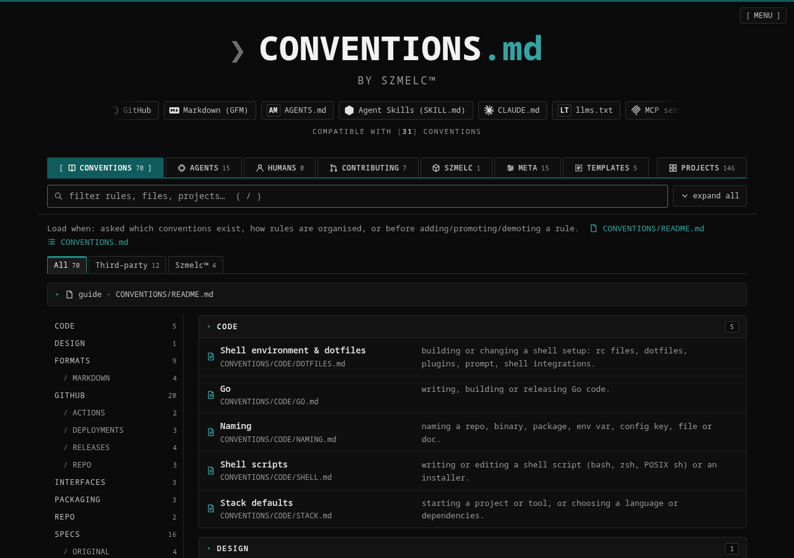
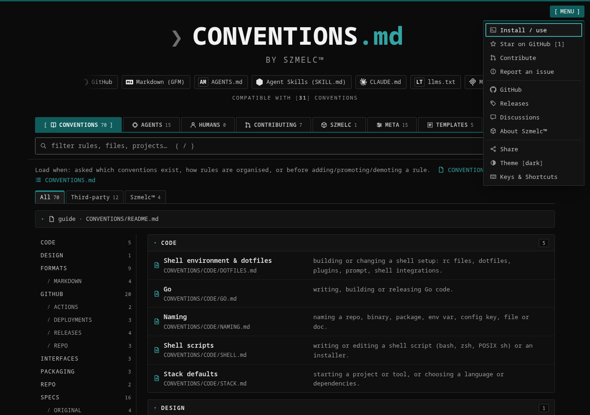
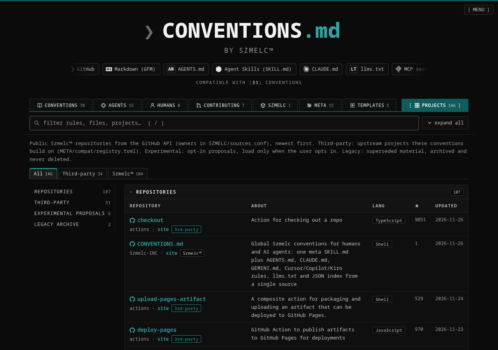

<div align="center">

# CONVENTIONS.md

**One set of rules for humans and AI agents, built into every format that agent tools read.**

```sh
git clone https://github.com/Szmelc-INC/CONVENTIONS.md ~/.config/szmelc/conventions && ~/.config/szmelc/conventions/install.sh
```

[](https://github.com/Szmelc-INC/CONVENTIONS.md/actions/workflows/check.yml)
[](https://github.com/Szmelc-INC/CONVENTIONS.md/releases/latest)
[](LICENSE)
[](https://szmelc-inc.github.io/CONVENTIONS.md/)

<a href="https://szmelc-inc.github.io/CONVENTIONS.md/"></a>

<sub>Live site: <a href="https://szmelc-inc.github.io/CONVENTIONS.md/">szmelc-inc.github.io/CONVENTIONS.md</a> · made by <a href="https://github.com/Szmelc-INC">Szmelc™</a></sub>

</div>

<details>
<summary><b>More screenshots</b> (click to expand)</summary>
<br>
<table>
<tr>
<td align="center" width="50%"><br><sub>[MENU]</sub></td>
<td align="center" width="50%"><br><sub>Projects</sub></td>
</tr>
<tr>
<td align="center"><br><sub>About popup</sub></td>
<td align="center"><br><sub>Phone</sub></td>
</tr>
</table>
</details>

## What it is
CONVENTIONS.md is one source of rules for code, repos, docs and AI agents.
A build script turns these rules into the formats that agent tools read: an Agent Skill, `AGENTS.md`, `CLAUDE.md`, `GEMINI.md`, and Cursor, Copilot and Kiro rules.
It also makes `llms.txt`, a JSON index and a bundle in one file.

Agents read [`INDEX.md`](INDEX.md) one time.
Then they load only the rule files that match the task.
This keeps the token cost low.

## Usage
### Install
```sh
git clone https://github.com/Szmelc-INC/CONVENTIONS.md ~/.config/szmelc/conventions
~/.config/szmelc/conventions/install.sh
```
The installer finds the agent tools on your machine.
It links the global rules into each tool.
For the list of tools, the flags and the setup for one project, read [`HUMANS/README.md`](HUMANS/README.md).

### Update
```sh
git -C ~/.config/szmelc/conventions pull
```
To pin a release, run `git -C ~/.config/szmelc/conventions checkout v2.0.0`.
After a major release, run `install.sh` again.

### Browse
Open the [live site](https://szmelc-inc.github.io/CONVENTIONS.md/).
- Each core has a tab. Each rule opens in place. You can copy a rule as Markdown or as a raw URL.
- The Projects tab shows all public Szmelc™ projects and the third-party projects that the rules use.
- `[MENU]` has install, star, share, theme and more.
- Press `?` on the site to see all keys.

## Compatible with
The rules work with 31 third-party formats, specs and tools.
Some examples are AGENTS.md, Agent Skills, `llms.txt`, MCP, Conventional Commits, SemVer, Nix flakes and Shields.io.

The full list is in [`COMPATIBILITY.md`](COMPATIBILITY.md).
The build makes that file from [`META/compat/registry.toml`](META/compat/registry.toml).
To add an entry, edit the registry and run `META/tools/build.sh`.

<sub>Names and logos belong to their owners. Szmelc™ is not affiliated with them.</sub>

## How it works
### Cores
The repo has seven cores.
A core is a directory with a guide (`README.md`) and a map file at the root (`X.md`).

| Core | What it has |
|---|---|
| [`CONVENTIONS/`](CONVENTIONS/README.md) | The rules, sorted by category |
| [`AGENTS/`](AGENTS/README.md) | Global rules for agents, prompts, skills, tool adapters |
| [`HUMANS/`](HUMANS/README.md) | How to install and browse |
| [`CONTRIBUTING/`](CONTRIBUTING/README.md) | How to add and change rules |
| [`SZMELC/`](SZMELC/README.md) | Szmelc™ organizations, sites and project sources |
| [`META/`](META/README.md) | Build tools, site, schema, compatibility registry |
| [`TEMPLATES/`](TEMPLATES/README.md) | Skeletons for new files |

### Build
`META/tools/build.sh` makes the generated files from the sources.
`META/tools/check.sh` checks the result.
Do not edit generated files by hand.

<details>
<summary><b>File layout</b> (click to expand)</summary>

```
SKILL.md          entry point, installed as the skill `szmelc-conventions`
INDEX.md          every file and when to load it                  [generated]
index.json        the same index as JSON                          [generated]
llms.txt          index in the llmstxt.org format                 [generated]
CONVENTIONS.md    all stable rules in one file                    [generated]
COMPATIBILITY.md  compatible formats, specs and tools             [generated]
AGENTS.md         rules for agents in this repo + map of AGENTS/  [map generated]
HUMANS.md CONTRIBUTING.md SZMELC.md META.md TEMPLATES.md  core maps   [generated]
CLAUDE.md GEMINI.md   import AGENTS.md
CONVENTIONS/      rules; EXPERIMENTAL/ proposals, LEGACY/ archive
AGENTS/ HUMANS/ CONTRIBUTING/ SZMELC/ META/ TEMPLATES/   the other cores
install.sh        installer for agent tools
CHANGELOG.md      release history
LICENSE           MIT
.github/          workflows, issue forms, PR template, labels
claude/           old install paths (symlinks)
public/           the built site, made in CI, never committed     [generated]
```
</details>

### Automation
- CI checks each PR: `META/tools/check.sh`, ShellCheck and the install test.
- GitHub Pages builds the site when its sources change on `main`, and each night at 03:00 UTC.
- A `vX.Y.Z` tag starts the release. The release gets the bundle files and `SHA256SUMS`.
- Dependabot opens one PR each week for GitHub Actions updates.

## Contributing
Read [`CONTRIBUTING/README.md`](CONTRIBUTING/README.md) first.

### Steps
1. Make a branch from `main` with one of these prefixes: `feat/*`, `fix/*`, `docs/*`, `chore/*`, `experimental/*` or `legacy/*`.
2. Edit only source files.
3. Run `META/tools/build.sh && META/tools/check.sh`. Both must pass.
4. Open a PR into `main`.
5. When CI is green, merge with `gh pr merge --rebase --delete-branch`.
6. Sync your copy with `git checkout main && git pull --ff-only`.

Rebase-merge puts each commit of the branch on `main`.
Make each commit clean and follow [Conventional Commits](CONVENTIONS/WORKFLOW/COMMITS.md).
For more, read [`CONVENTIONS/WORKFLOW/BRANCHES.md`](CONVENTIONS/WORKFLOW/BRANCHES.md).

### Rules of this repo
1. One topic = one file. One rule = one line.
2. Every rule file and core `README.md` starts with `# Title` and `> Load when: <trigger>`.
3. Do not copy a rule. Link to it by path (`CONVENTIONS/DESIGN/COLORS.md`).
4. Do not edit generated files. Run `META/tools/build.sh`, then `META/tools/check.sh` (CI runs both).
5. For a new topic, copy `TEMPLATES/rule.md`. Format and names: `CONVENTIONS/SPECS/ORIGINAL/RULE-FILES.md`. For a new core, add the directory and its `README.md`, then add the core to `CORES` in `META/tools/build.sh`, `META/tools/check.sh` and `META/tools/site.sh`.
6. Agents read `INDEX.md` one time, then only the matching files. Do not `@import` rule files into global instructions. That loads every rule in every session.
7. This repo is public. Add only material that is already public.

## License
[MIT](LICENSE) © Szmelc™
