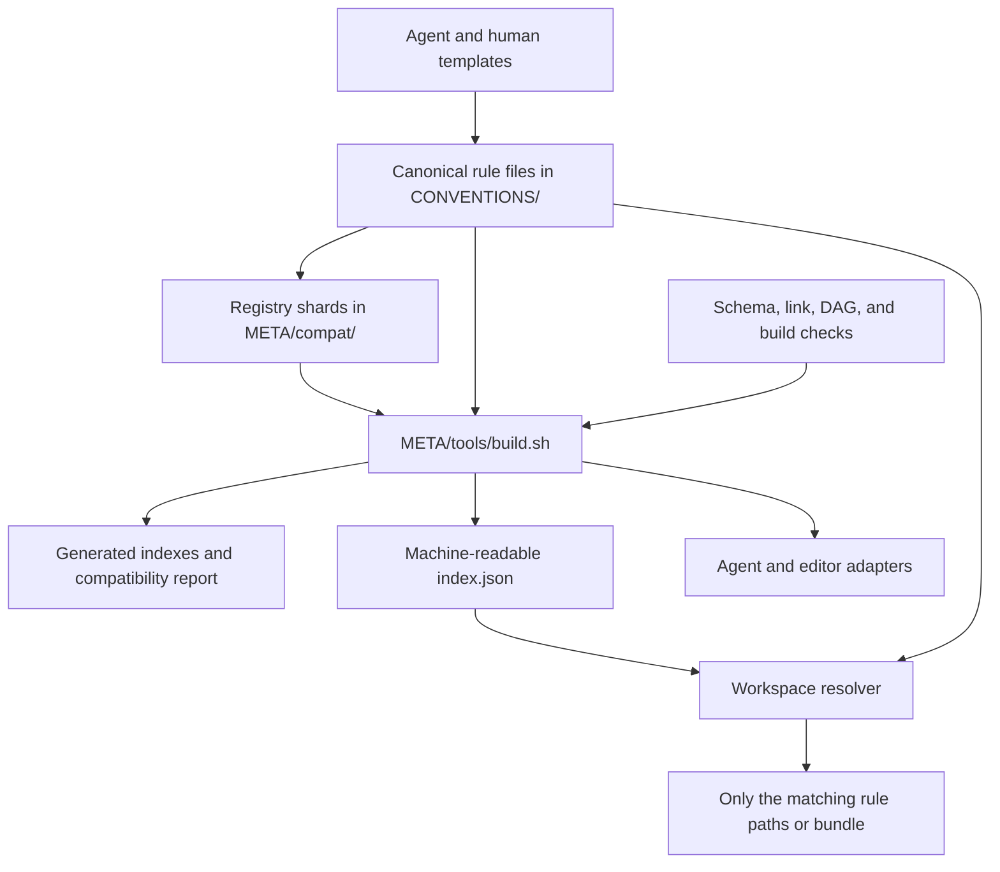

# Proposal 0002: Universal conventions and agent context system

> Status: proposal, accepted in part. Decisions and mapping: [`SPEC/decisions/0002-context-system.md`](../decisions/0002-context-system.md).
> Source: consolidated design document supplied by the maintainer on 2026-11-26. It describes a target architecture, not the implemented state.
>
> **One source of truth. Small context. Exact rules. Repeatable builds.**
>
> A portable convention system for developers, repositories, command-line tools, IDEs, and AI coding agents.

---

## 1. What this project is

**Szmelc Conventions** is a shared rule system for software work. It stores technical conventions, repository rules, standards, and agent instructions in one structured place. A build process turns that source into files understood by different tools.

The system has two jobs:

1. **Define rules once.** A rule lives in one canonical Markdown file. Its identity, category, trigger, dependencies, and links live in structured metadata.
2. **Deliver the right rules to the right tool.** A compiler creates compatible files for agents and editors. A resolver selects only the rules that match the current repository or task.

The goal is not to make every agent read thousands of rules. The goal is to make every agent able to find the few rules that matter.

### Core goals

- Keep one canonical source for each rule.
- Support many AI coding agents without copying and maintaining the same text by hand.
- Separate agent-specific file formats from general engineering conventions.
- Use progressive disclosure to control context size.
- Detect relevant rules from file names, extensions, paths, and explicit task triggers.
- Track rule dependencies and cross-references as data.
- Validate the registry, links, dependency graph, and generated output.
- Keep builds deterministic and suitable for local use and CI.
- Make standards discoverable without pretending that every standard is a rule the project implements.
- Allow the catalogue to grow without turning the root README or agent entry point into a giant prompt.

### Non-goals

This repository is not:

- A replacement for the official text of external standards.
- A claim that every listed format is fully implemented or verified.
- A requirement to use every tool, framework, language, or protocol in the catalogue.
- A giant prompt that must be loaded in full for every task.
- A runtime framework that executes arbitrary commands from Markdown or TOML.
- A guarantee that every third-party agent supports the same file format or hook API.

> **Important status note:** This README describes the consolidated target architecture represented by the design material. A format, rule, adapter, script, or standard is only *implemented* when the corresponding file exists and passes the project checks. Catalogue ideas and examples are not proof of implementation.

---

## 2. The central architecture

The system is split into six parts. Each part has one clear responsibility.

| Part | Main location | Responsibility |
|---|---|---|
| Canonical rules | `CONVENTIONS/` | Human-readable rules, grouped by topic |
| Agent-native guidance | `AGENTS/` | Agent formats, adapter guidance, hooks, and session behavior |
| Templates | `TEMPLATES/` | Reusable source templates for rule and metadata files |
| Registry | `META/compat/` | Machine-readable rule metadata, split into domain shards |
| Compiler and checks | `META/tools/` | Build generated files and validate the source graph |
| Generated interfaces | Repository root and tool-specific folders | `SKILL.md`, `AGENTS.md`, `index.json`, domain indexes, and other outputs |

The information path is:



### 2.1 Source-of-truth rule

A rule must have one canonical file. Tool-specific output is a **projection** of that rule, not a second source.

For example, an instruction about safe shell scripting should live in one file under `CONVENTIONS/ENVIRONMENT/` or `CONVENTIONS/LANGUAGES/`. The compiler may place a shortened or adapted version in `AGENTS.md`, `CLAUDE.md`, `.cursor/rules/*.mdc`, or another target. Editing generated output directly is not the normal workflow.

### 2.2 Two different kinds of registry data

The registry must not mix these two concepts:

- **Rule entries:** a convention that the project stores, routes, or enforces. A rule entry points to a canonical rule file.
- **Adapter targets:** a file or configuration shape that a compiler can generate for a particular tool.

A target such as `.cursor/rules/*.mdc` is not itself an engineering rule. Likewise, a standard such as RFC 9457 is not an output adapter. Keep these records separate, even when one rule is delivered through many targets.

A practical model is:

```text
META/
├── compat/                 # Rule metadata, split into topic shards
│   ├── agents.toml
│   ├── workflow.toml
│   ├── security.toml
│   ├── languages.toml
│   └── ...
├── adapters/               # Output target definitions and mappings
│   ├── targets.toml
│   └── ...
├── schema/                 # JSON Schema and registry contracts
└── tools/                  # Build, validation, and resolution tools
```

If an existing repository still uses `META/compat/registry.toml`, it can remain the initial single shard. Split it only when the registry becomes large enough to create merge conflicts or make review difficult.

---

## 3. Design principles and invariants

These rules govern the convention system itself.

### 3.1 One topic, one canonical rule

- Each rule file covers one topic or one tightly related group.
- Do not copy a full rule into another domain just to make it easier to find.
- Use links for related topics and `requires` for true loading dependencies.
- Split a file when it becomes difficult to load or review as one unit.
- Merge files only when the topics cannot be used or understood separately.

### 3.2 Progressive disclosure by default

The corpus may contain thousands of rules. Normal agent startup must not load the whole corpus.

Use three levels:

| Level | Typical files | What gets loaded |
|---|---|---|
| **Tier 0 — Universal entry** | `AGENTS.md`, `SKILL.md` | Short global invariants and directions to the index |
| **Tier 1 — Domain router** | Root `INDEX.md` | Domain names, domain indexes, and short trigger summaries |
| **Tier 2 — Specific rules** | `CONVENTIONS/<DOMAIN>/INDEX.md` and rule files | Only matching rules and their declared prerequisites |

The root entry should stay short. A target of roughly 80 lines is a useful starting point, not a hard limit. It should explain how to find rules, not repeat the entire rule collection.

### 3.3 Rules are not standards

A standard is an external specification, protocol, schema, or accepted practice. A project rule tells contributors or agents what to do with it.

Every external reference should be clear about its role:

- **Normative:** required by this repository or profile.
- **Recommended:** preferred when the technology applies.
- **Informational:** useful background or a pointer to an external source.
- **Experimental:** under evaluation and not yet a stable project requirement.

Do not turn every catalogue entry into a mandatory rule. Use the smallest set that fits the actual project.

### 3.4 Do not invent certainty

- Link to authoritative specifications where possible.
- Record the version or revision being discussed.
- Mark unverified or proposed entries as such.
- Record exceptions and scope limits.
- Do not describe a tool as supported until an adapter has been tested.
- Do not claim a security property merely because a standard or scanner is listed.

### 3.5 Deterministic output

The same source files and tool versions should produce the same generated files.

- Sort file discovery and registry records.
- Normalize line endings to LF.
- Use UTF-8.
- Use stable IDs and stable ordering.
- Do not insert timestamps or random values into generated content unless the timestamp is part of a deliberate release artifact.
- Fail on duplicate IDs, invalid paths, missing dependencies, or malformed metadata.

### 3.6 Keep relationships explicit

The system uses different relationship types for different purposes:

| Relationship | Meaning | Direction |
|---|---|---|
| `requires` | A rule needs another rule to be loaded first | Directed dependency |
| `links` | Two rules are related and should be discoverable together | Usually symmetric |
| `detect` | Workspace file signatures that may trigger a rule | Match pattern, not a dependency |
| `signals` / escalation metadata | A rule or event alerts another supervisory layer | Directed signal, not a load dependency |

Do not treat every Markdown link as a dependency. Do not require a back-link for every directed dependency. A dependency graph and a related-topic graph are different graphs.

---

## 4. Repository layout

The following layout is the recommended shape. It is a target tree, not a claim that every path already exists.

```text
.
├── README.md
├── CONVENTIONS.md               # Optional full offline bundle / archive
├── AGENTS.md                    # Short universal agent entry point
├── SKILL.md                     # Agent Skill entry point
├── CLAUDE.md                    # Generated adapter output, if enabled
├── GEMINI.md                    # Generated adapter output, if enabled
├── DESIGN.md                    # Design-system summary, if enabled
├── HUMANS.md                    # Human-facing workflow summary, if enabled
├── INDEX.md                     # Generated Tier-1 domain router
├── COMPATIBILITY.md             # Generated compatibility report
├── index.json                   # Generated machine-readable catalog
├── AGENTS/
│   ├── INDEX.md
│   ├── SESSION-HOOKS.md
│   └── adapters/
│       ├── claude-settings.hooks.json
│       ├── gemini-settings.hooks.json
│       └── ...
├── CONVENTIONS/
│   ├── INDEX.md                 # Optional source-controlled router
│   ├── AGENTS/
│   ├── PROTOCOLS/
│   ├── WORKFLOW/
│   ├── DOCS/
│   ├── APIS/
│   ├── DATA/
│   ├── ENVIRONMENT/
│   ├── PACKAGING/
│   ├── SECURITY/
│   ├── AGENT-SAFETY/
│   ├── SPECS/
│   │   ├── ORIGINAL/
│   │   └── THIRD-PARTY/
│   ├── DESIGN/
│   ├── WEB/
│   ├── LANGUAGES/
│   ├── CICD/
│   ├── INFRA/
│   ├── OBSERVABILITY/
│   ├── AI-ML/
│   ├── DATA-FORMATS/
│   ├── CRYPTO-AUTH/
│   ├── IETF-RFCS/
│   ├── IETF-RFCS-EXTENDED/
│   ├── WEB-PLATFORM/
│   ├── WEB-FRAMEWORKS/
│   ├── DATABASES/
│   ├── CLI-TUI/
│   ├── CLOUD-K8S/
│   ├── DISTRIBUTED-SYSTEMS/
│   ├── COMPILERS-RUNTIMES/
│   ├── AI-AGENT-INTEROP/
│   ├── AGENT-ECOSYSTEM/
│   ├── SECURITY-COMPLIANCE/
│   ├── CRYPTOGRAPHY-PRIMITIVES/
│   ├── MEDIA-GRAPHICS/
│   ├── SCIENCE-GEOSPATIAL/
│   ├── EMBEDDED-IOT-ROBOTICS/
│   ├── DATA-SCIENCE-MLOPS/
│   ├── BUSINESS-FINANCE-COMMERCE/
│   ├── ENTERPRISE-IT-OPS/
│   ├── INDUSTRY-VERTICALS/
│   ├── SZMELC-AND-META/
│   ├── META-PATTERNS-550/
│   ├── EPISTEMOLOGY/
│   ├── MATH-ALGO/
│   ├── HCI-DESIGN/
│   ├── ONTOLOGY/
│   ├── LOGIC/
│   ├── METAPHYSICS/
│   ├── CYBERNETICS/
│   └── ...
├── TEMPLATES/
│   ├── rule.md
│   ├── registry-entry.toml
│   └── ...
└── META/
    ├── compat/
    │   ├── agents.toml
    │   ├── protocols.toml
    │   ├── workflow.toml
    │   ├── security.toml
    │   └── ...
    ├── adapters/
    │   └── targets.toml
    ├── schema/
    │   └── index.v1.json
    └── tools/
        ├── build.sh
        ├── build-shards.sh
        ├── check.sh
        ├── check-schema.sh
        ├── check-links.sh
        └── resolve-context.sh
```

### 4.1 Folder responsibilities

- `AGENTS/` contains agent-specific behavior and adapter instructions. It should not become a duplicate home for generic software rules.
- `CONVENTIONS/` contains reusable rules that apply to humans, agents, or both.
- `CONVENTIONS/SPECS/ORIGINAL/` may hold project-authored specifications.
- `CONVENTIONS/SPECS/THIRD-PARTY/` may hold summaries and usage rules for external specifications.
- `TEMPLATES/` contains the canonical shapes used to add new rules and metadata.
- `META/compat/` contains metadata only. It should not become a second prose documentation tree.
- `META/adapters/` defines output formats and target mappings.
- `META/schema/` defines machine-readable contracts.
- `META/tools/` contains the build and verification commands.

### 4.2 Naming conventions

- Use uppercase domain directories when that matches the existing repository style.
- Use descriptive kebab-case file names for multi-word topics.
- Use stable, lowercase kebab-case IDs in machine metadata.
- Use `INDEX.md` for generated domain maps.
- Use `README.md` for a human-facing overview of a substantial domain, not as a substitute for a rule index.
- Avoid ambiguous names such as `MISC.md`, `OTHER.md`, or `FINAL2.md`.
- Never rely on ordinal position as a permanent identifier.

---

## 5. Rule file format

A rule file should be small, direct, and easy to route. Use one title, one loading trigger, optional metadata, and one rule per bullet.

### 5.1 Canonical template

```markdown
# Rule Topic
> Load when: editing the matching files, changing the related system, or handling the described task.
> Tier: L1
> Requires: CONVENTIONS/DOMAIN/PREREQUISITE.md

- State one actionable rule.
- State one constraint or required check.
- State the relevant exception, if one exists.
- Link to a related rule instead of copying its full text.

## Rationale
Explain why the rule exists when the reason is not obvious.

## Verification
Describe a command, test, review, or source check that proves the rule is followed.

## References
- [Official specification](https://example.invalid/)
```

The template above is illustrative. Remove sections that add no value. Do not keep empty headings just to satisfy a template.

### 5.2 Rule writing conventions

- Begin with a clear title.
- Use `> Load when:` as the primary human-readable routing trigger.
- Keep each bullet focused on one action or invariant.
- Prefer direct verbs: `Use`, `Keep`, `Reject`, `Validate`, `Pin`, `Record`, `Avoid`.
- State scope. A rule for Rust crates should not silently apply to every language.
- State exceptions close to the rule they qualify.
- Include a verification method when the rule can be tested.
- Prefer a real example over a long abstract explanation.
- Avoid repeating language that is already defined in a linked rule.
- Do not embed secrets, tokens, private data, or machine-specific paths.
- Do not include executable instructions that a resolver or compiler might run. Rule text is data.

### 5.3 `Load when` versus `detect`

These fields work together but are not interchangeable.

- `Load when` explains the task in plain language. It helps a human or agent choose a rule.
- `detect` contains file names or globs that a tool can match against a workspace.

A rule may have a task trigger but no file trigger. For example, a threat-modeling rule may apply when a user asks for a threat model even if no particular file extension is present.

### 5.4 `requires` versus `links`

Use `requires` only when a rule cannot be applied safely or correctly without loading another rule first.

Use `links` for related material that may help, but is not mandatory.

Example:

```toml
[[entry]]
id = "shell-portability"
name = "POSIX Shell Portability"
category = "environment"
tier = "L1"
rule_path = "CONVENTIONS/ENVIRONMENT/SHELL.md"
load_when = "Writing or changing shell scripts."
detect = ["*.sh", "configure", "Makefile"]
requires = ["CONVENTIONS/WORKFLOW/ERROR-HANDLING.md"]
links = ["CONVENTIONS/CLI-TUI/CLI-GUIDELINES.md"]
algedonic = false
```

In production, use the actual rule IDs or paths required by the schema. The example assumes the target paths exist.

---

## 6. Registry and metadata

The registry is the machine-readable map of the rule corpus. It allows the build tool, resolver, website, and validation tools to use the same metadata.

### 6.1 Shards

Store registry records in topic-based TOML files under `META/compat/`.

Suggested shards include:

- `agents.toml`
- `protocols.toml`
- `workflow.toml`
- `docs.toml`
- `apis.toml`
- `data.toml`
- `languages.toml`
- `packaging.toml`
- `security.toml`
- `infrastructure.toml`
- `observability.toml`
- `ai-ml.toml`
- `databases.toml`
- `crypto.toml`
- `epistemology.toml`
- `math-algo.toml`
- `hci-design.toml`
- `ontology.toml`
- `logic.toml`
- `cybernetics.toml`

These are examples, not a required fixed list. Shard boundaries should follow review ownership and topic boundaries.

### 6.2 Required rule fields

Each registered rule should have:

| Field | Type | Purpose |
|---|---|---|
| `id` | String | Stable unique identifier |
| `name` | String | Human-readable rule name |
| `category` | String | Domain or topic category |
| `tier` | `L0`–`L5` or defined profile tier | Logical level used by routing or governance |
| `rule_path` | Repository path | Canonical Markdown rule file |
| `load_when` | String | Human-readable trigger |
| `detect` | Array of globs | Workspace file signatures |
| `requires` | Array of paths or IDs | Directed load prerequisites |
| `links` | Array of paths or IDs | Related rules |
| `algedonic` | Boolean | Explicit exceptional escalation/dependency marker, if used |
| `source_shard` | Generated field | Shard that supplied the record |

The compiled `index.json` should also carry the schema version and generator version. The exact contract belongs in `META/schema/`.

### 6.3 Recommended lifecycle fields

The larger catalogue needs a way to show how mature an entry is. Add lifecycle metadata before treating the entire catalogue as production policy.

Recommended fields:

- `status`: `proposed`, `draft`, `verified`, `deprecated`, or `retired`.
- `source`: one or more official specification URLs or authoritative references.
- `version`: the exact external version or revision covered.
- `verified_at`: date of the last source review, in ISO 8601 format.
- `scope`: the technology, project profile, or system boundary where the rule applies.
- `owner`: a team or maintainer responsible for review.

Do not mark a rule `verified` just because its title looks familiar. Verification means the source was checked and the rule was compared against it.

### 6.4 Identity and lifecycle

- Once published, an `id` should remain stable.
- Do not silently reuse an old ID for a new topic.
- When a rule is replaced, mark the old record as deprecated and point to its successor.
- Prefer a stable rule path, but allow a controlled path migration with a clear history.
- Do not use list position or catalogue number as identity.
- Record aliases when old IDs or paths must remain resolvable.

### 6.5 Shard validation

The registry compiler should reject:

- Missing IDs or names.
- Duplicate IDs.
- Duplicate canonical rule paths.
- Missing rule files.
- Unknown fields that are not permitted by the schema.
- Invalid tier values.
- Malformed globs or paths.
- Self-dependencies.
- Missing `requires` targets.
- Dependency cycles.
- Invalid `links` targets.
- Invalid adapter references.

Do not silently repair invalid metadata during a build. Print the exact file and entry that failed.

---

## 7. Generated catalog and index formats

Generated files are views of the source data. They should be rebuilt, not manually curated.

### 7.1 `index.json`

`index.json` is the machine-readable contract used by tooling. It should include:

- A real JSON Schema Draft 2020-12 URI.
- An explicit schema or index version.
- The generated total entry count.
- The list of domain identifiers.
- A stable, deterministically sorted list of entries.
- For each entry: ID, name, category, tier, rule path, trigger, detect patterns, prerequisites, related links, status, provenance, and source shard where available.

The total count must be computed from the final entry list. Never type a count into the file by hand.

### 7.2 `INDEX.md`

The root `INDEX.md` is a small domain router. It should show:

- Domain name.
- Domain index path.
- Number of registered rule files in that domain.
- Short task or file trigger summary.

It should not list every rule in every domain.

### 7.3 `CONVENTIONS/<DOMAIN>/INDEX.md`

Each domain index provides the next level of detail:

- Rule file path.
- Rule title.
- Tier.
- `Load when` trigger.
- `requires` prerequisites.
- `detect` patterns.
- Lifecycle status, when available.

### 7.4 `COMPATIBILITY.md`

This generated report explains which rules and formats are represented in the registry. It may include:

- Rule ID and name.
- Domain and tier.
- Canonical rule path.
- File-detection patterns.
- Supported agent or editor targets.
- Status and last verification date.

Do not confuse a listed adapter target with tested support. Use separate statuses such as `planned`, `generated`, and `tested`.

### 7.5 Full bundle

`CONVENTIONS.md` may be generated as a full offline bundle for archival search, RAG ingestion, or environments that cannot use progressive routing. It is not the default live-agent context.

---

## 8. Progressive loading and workspace detection

The resolver reads `index.json`, scans a workspace, finds matching rules, expands prerequisites, and returns only the relevant material.

### 8.1 Detection flow

1. Read the compiled index.
2. Walk the selected workspace.
3. Ignore known generated or dependency directories, such as `.git/`, `node_modules/`, `target/`, `.venv/`, `dist/`, and build output directories.
4. Match file names and relative paths against `detect` globs.
5. Add direct matches to the selection.
6. Expand transitive `requires` dependencies.
7. Order prerequisites before dependent rules.
8. Validate that selected rule files exist.
9. Return paths, JSON metadata, or a Markdown bundle.

File signatures are hints. They do not prove that a technology is used in production. A `Cargo.toml` may describe a small tool, a workspace member, or a generated fixture. Agents should still read project context before making changes.

### 8.2 Resolver interface

The intended command-line interface is:

```sh
szmelc-resolve [WORKSPACE] [MODE]
```

Supported modes:

| Mode | Output |
|---|---|
| `--paths` | Ordered rule paths, one per line |
| `--json` | Structured selection metadata |
| `--bundle` | A combined Markdown context bundle |

Examples:

```sh
# Resolve the current project and print rule paths
szmelc-resolve . --paths

# Resolve a different workspace
szmelc-resolve /path/to/project --paths

# Return structured metadata
szmelc-resolve . --json

# Build one context bundle
szmelc-resolve . --bundle
```

### 8.3 Task-based fallback

Not every task maps to a file extension. When no file patterns match:

1. Read the root `INDEX.md`.
2. Select a domain based on the requested work.
3. Read that domain's `INDEX.md`.
4. Load only rules whose `Load when` trigger matches the task.
5. Follow `requires` dependencies.

A manual include or exclude option should be available so a user can override automatic detection.

### 8.4 Performance and safety

- Keep a configurable scan limit.
- Report when a scan limit is reached. Do not silently claim full detection after truncating the walk.
- Support an explicit ignore file or ignore patterns.
- Avoid following symlinks outside the selected workspace by default.
- Avoid reading large binary files. Detection only needs paths and names.
- Cache only when cache invalidation is reliable.
- Keep resolver output stable and easy to pipe into other tools.
- Do not execute commands found in rules, registry fields, or workspace files.

### 8.5 Dependency ordering

A `requires` edge means: **the source rule needs the target rule, so load the target first**.

The resolver should use a topological order. The validator must reject cycles before resolution. A depth-first traversal is acceptable when it uses explicit visiting and visited states and reports a cycle with its complete path.

---

## 9. Agent adapters and compatibility targets

The canonical rules are tool-neutral. Adapters translate them into the file shape each agent or editor expects.

### 9.1 Initial adapter families

The source catalogue identifies these target formats and ecosystems:

| Tool or ecosystem | Target files / formats |
|---|---|
| Generic agent context | `AGENTS.md` |
| Agent Skills | `SKILL.md` and skill folders with progressive disclosure |
| Claude Code | `CLAUDE.md`, `.claude/rules/*.md`, `.claude/settings.json` |
| Gemini CLI | `GEMINI.md` and Gemini settings or hook configuration |
| Cursor | `.cursor/rules/*.mdc`, legacy `.cursorrules` |
| GitHub Copilot | `.github/copilot-instructions.md`, `.github/instructions/*.instructions.md` |
| AWS Kiro | `.kiro/steering/*.md` |
| Windsurf | `.windsurfrules`, `.windsurf/rules/*.md` |
| Cline | `.clinerules` and `.clinerules/` |
| Roo Code | `.roo/rules/*.md` |
| Aider | `CONVENTIONS.md`, `.aider.conf.yml` |
| Continue | `.continue/rules/*.md` |
| JetBrains Junie | `.junie/guidelines.md` |
| Project IDX / Firebase Studio | `.idx/airules.md` |
| Amazon Q Developer | `.amazonq/rules/*.md` |
| Replit Agent | `replit.md` |
| Warp | `WARP.md` |
| OpenCode | `OPENCODE.md`, `opencode.json` |
| LLM content discovery | `llms.txt`, `llms-full.txt` |
| Design-aware agents | `DESIGN.md` |
| Agent persona and memory | `SOUL.md`, `MEMORY.md`, portable memory metadata |
| Zed and other editor clients | Their native rule or ACP-compatible interfaces |

This table is a target catalogue. File support, rule precedence, frontmatter, globs, hook schemas, and discovery behavior can change between tool versions. Each adapter must be checked against the tool's current official documentation before release.

### 9.2 Adapter contract

Each adapter should define:

- Target ID and display name.
- Output path or path pattern.
- Supported metadata fields.
- Required frontmatter or JSON structure.
- Whether it supports path-scoped rules.
- Whether it supports hooks or session injection.
- Known size or context limits.
- Generator version.
- Compatibility test status.

If the target cannot represent a source feature, the adapter must handle it deliberately. It may omit an optional field, add a comment, or emit a warning. It must not silently change the rule's meaning.

### 9.3 Adapter output rules

- Preserve the meaning of the source rule.
- Include a source path or stable ID where the target supports it.
- Keep generated files marked as generated.
- Do not overwrite user-authored files without an explicit policy.
- Do not flatten path-specific rules into global instructions unless that is the intended fallback.
- Keep tool-specific syntax out of the canonical rule file.
- Generate only enabled targets.
- Test the output with fixtures for each supported adapter.

### 9.4 Progressive disclosure for adapters

Where a target supports only one global instruction file, emit a short router and provide paths to the detailed rules. Where it supports scoped rules, generate scoped outputs with the correct path globs. Do not paste the entire rule corpus into every target by default.

---

## 10. Agent protocols and interoperability

Agent configuration files and agent communication protocols are separate subjects.

The catalogue includes:

- **MCP:** Model Context Protocol, tool-server manifests, discovery, and transport conventions.
- **A2A:** Agent-to-Agent communication, agent cards, and discovery endpoints.
- **ACP:** Agent Client Protocol and editor-to-agent communication.
- **Tool schemas:** structured tool/function definitions and validation.
- **Skill registries:** skill metadata and packaging formats.
- **Orchestration:** LangGraph, CrewAI, AutoGen, Mastra, and related multi-agent configuration.
- **Evaluation:** Promptfoo, Inspect AI, and agent evaluation suites.
- **Guardrails:** policy boundaries, constrained execution, and safety checks.
- **Telemetry:** OpenTelemetry GenAI conventions, traces, and metrics.
- **Memory:** portable memory structures, retrieval, provenance, and retention policies.

A protocol rule should identify the exact version and source. A tool-specific adapter should remain separate from a protocol specification. Do not label a project-specific JSON file as a universal standard unless an authoritative specification defines it.

---

## 11. Security, privacy, and trust boundaries

The convention system itself is part of the software supply chain. Treat its metadata, generated output, install process, and agent hooks as security-sensitive configuration.

### 11.1 Registry and rule safety

- Treat external rule packs and registry files as untrusted until reviewed.
- Do not execute shell commands stored in `detect`, `requires`, `links`, or prose fields.
- Validate paths and reject `..` traversal outside the repository.
- Reject unknown adapter commands and arbitrary runtime hooks.
- Keep credentials out of rules, examples, logs, and generated context bundles.
- Redact secrets and personal data from diagnostic output.
- Pin external dependencies used by build or validation workflows.

### 11.2 Installation safety

An installer should:

- Use XDG paths where appropriate.
- Prefer `~/.local/bin` for user-level commands unless `XDG_BIN_HOME` is set.
- Make changes idempotently.
- Preserve unrelated user settings.
- Create a backup before changing a configuration file.
- Offer dry-run and uninstall behavior.
- Ask before enabling optional session hooks or modifying global agent configuration.
- Avoid requiring root for user-level installation.
- Print every file it creates or changes.

A claim that a hook merge is non-destructive must be backed by tests. JSON parse failure must not result in replacing the user's file with a new empty configuration.

### 11.3 Security and compliance coverage

The catalogue includes, among other areas:

- Vulnerability disclosure and `SECURITY.md`.
- `security.txt` and coordinated disclosure.
- OWASP Top 10, ASVS, API Security, MASVS, and LLM/agent security.
- NIST Cybersecurity Framework, NIST SP 800-53, and Zero Trust concepts.
- ISO 27001, SOC 2, GDPR, HIPAA, PCI DSS, and EU AI Act topics.
- Threat modeling with STRIDE and PASTA.
- CVE, CWE, CVSS, CSAF, and VEX.
- SLSA, SBOM, Sigstore, Cosign, OpenSSF Scorecard, and reproducible builds.
- Secret scanning, secret storage, workload identity, and key rotation.
- Secure authentication, authorization, TLS, and browser security controls.
- Fuzzing, property-based testing, mutation testing, and deterministic builds.

The presence of a framework in this catalogue does not mean the repository is certified or compliant. Compliance claims require scope, evidence, control mapping, and review.

---

## 12. Build system

The compiler turns canonical Markdown and TOML metadata into the generated views.

### 12.1 Main commands

The intended command layout is:

| Command | Role |
|---|---|
| `META/tools/build.sh` | Main build entry point |
| `META/tools/build-shards.sh` | Merge TOML shards and compile indexes and reports |
| `META/tools/check.sh` | Run the full local validation pipeline |
| `META/tools/check-schema.sh` | Validate `index.json` against its schema and structural invariants |
| `META/tools/check-links.sh` | Validate rule paths, links, dependency DAG, and tier rules |
| `META/tools/resolve-context.sh` | Resolve rules for a workspace |

The exact script split may change, but the responsibilities should stay separate.

### 12.2 Build stages

1. Find all rule Markdown files in a deterministic order.
2. Parse titles and `Load when` metadata.
3. Load and merge all TOML shards.
4. Reject duplicate IDs and duplicate rule paths.
5. Validate every registered path.
6. Add unregistered Markdown files only if the project explicitly permits automatic discovery. Prefer failing with an orphan report over silently inventing IDs.
7. Build the `index.json` entries.
8. Generate root `INDEX.md` and per-domain `INDEX.md` files.
9. Generate `COMPATIBILITY.md`.
10. Generate enabled agent and editor outputs.
11. Optionally generate the full offline bundle.
12. Write files atomically and report the result.

### 12.3 Build quality rules

- Do not write partial outputs when validation fails.
- Write to temporary files, then rename into place.
- Preserve stable sorting and UTF-8 output.
- Escape Markdown table values safely.
- Validate generated JSON after writing it.
- Do not include machine-specific absolute paths in generated files.
- Detect output collisions before writing adapter targets.
- Print a useful summary: rules, domains, shards, adapters, warnings, and errors.

### 12.4 Runtime requirements

The shell entry points are intended to use POSIX shell. The examples in the design use Python's standard library for TOML and JSON handling. In particular, Python's built-in `tomllib` requires Python 3.11 or newer. Therefore, describe the tools as **POSIX-shell entry points with a Python 3.11+ helper requirement**, unless the implementation is changed to use another TOML parser or runtime.

Do not call the entire toolchain zero-dependency if it requires Python 3.11. Optional libraries such as `jsonschema` may improve validation, but the base structural checks should not depend on them unless that dependency is declared.

---

## 13. Validation and CI

Validation is a required part of the architecture. A registry that compiles but contains broken paths or dependency cycles is not a healthy registry.

### 13.1 Required checks

| Check | What it protects against |
|---|---|
| Markdown structure | Missing title, missing `Load when`, malformed rule layout |
| TOML parsing | Invalid shard syntax |
| Registry schema | Missing fields, wrong types, invalid IDs, invalid tiers |
| ID uniqueness | Duplicate identity |
| Path integrity | Missing rule files and invalid repository paths |
| Orphan scan | Rule files that are not registered |
| Link integrity | Broken related-rule references |
| Dependency integrity | Missing prerequisites and self-dependencies |
| DAG validation | Cycles in `requires` |
| Tier validation | Invalid cross-tier dependency direction |
| Adapter validation | Unsupported fields, malformed output, path collisions |
| Deterministic build | Generated files changing without source changes |
| Resolver tests | Correct pattern matching and prerequisite ordering |
| Install tests | Idempotence, backups, preservation, and uninstall behavior |

### 13.2 Link graph rules

Keep related links and loading dependencies separate:

- `links` may be required to be symmetric if the project chooses a fully bidirectional related-topic graph.
- `requires` is directed. It does not need a reverse edge.
- Every `requires` target must exist.
- A rule must not require itself.
- The `requires` graph must be acyclic.
- If Markdown prose declares a structured relationship, the validator should compare it with the registry or generate the prose link from metadata. Avoid maintaining two independent copies of the same edge.

### 13.3 Tier rules

The L0–L5 model can be used to constrain dependencies. Define the direction once and test it consistently.

A safe default is:

- A lower operational tier must not require a higher governance tier to execute.
- A higher tier may require lower-level foundations.
- A `requires` chain must not skip tiers unless the architecture explicitly allows it.
- Emergency escalation is a signal, not a normal prerequisite.

The source design includes an `algedonic` exception for exceptional escalation. Keep this exception narrow, explicit, and separately tested. Do not use it to hide an ordinary dependency cycle or to bypass normal validation.

### 13.4 CI workflow

A CI job should run the same checks as a local contributor:

```sh
sh META/tools/build.sh
sh META/tools/check-schema.sh
sh META/tools/check-links.sh
sh META/tools/check.sh
```

Use one canonical orchestration command in practice. The sequence above shows the responsibilities. Avoid running the same build stage twice if `check.sh` already calls it.

After generation, CI should verify that the working tree is clean. A pull request that changes source rules but forgets generated outputs should fail with a clear instruction to rebuild.

### 13.5 Test fixtures

Keep small fixture workspaces for common signatures:

- Python project: `pyproject.toml`, `*.py`.
- Node project: `package.json`, `tsconfig.json`, `*.ts`, `*.tsx`.
- Rust project: `Cargo.toml`, `*.rs`.
- Go project: `go.mod`, `*.go`.
- Container project: `Dockerfile`, `compose.yaml`.
- Infrastructure project: `*.tf`, `terragrunt.hcl`, Kubernetes manifests.
- Web project: `package.json`, `vite.config.*`, HTML/CSS/JS files.
- Agent project: `AGENTS.md`, `SKILL.md`, MCP manifests, and agent adapter configs.
- Documentation-only project: Markdown, AsciiDoc, or reStructuredText files.

Test both positive and negative matches. A resolver that matches everything is not useful.

---

## 14. Installation and agent session hooks

The intended user-level command is `szmelc-resolve`. It should be installed into:

```text
${XDG_BIN_HOME:-$HOME/.local/bin}
```

The installed wrapper should call the repository's resolver and pass through the workspace and mode arguments.

### 14.1 Optional session hooks

The design includes optional session-start integration for agents that support command hooks. The first examples cover Claude Code and Gemini CLI. Other tools may use a different hook schema or may not support this mechanism at all.

A hook should:

1. Check whether `szmelc-resolve` exists.
2. Run the resolver for the active workspace.
3. Return only the matching rule paths by default.
4. Tell the agent to read those files before editing.
5. Exit cleanly when the tool is not installed or no rules match.
6. Have a short timeout.

Injecting paths is usually better than injecting the complete bundle. The agent can read the selected files on demand.

### 14.2 Hook safety

- Hooks are opt-in.
- Confirm the current agent's hook schema before installing.
- Do not replace existing hooks.
- Do not delete unknown hook entries.
- Back up settings before changes.
- Make installation idempotent.
- Add a dry-run mode.
- Provide a clean uninstall path.
- Keep the hook command narrow and predictable.
- Never execute commands copied from a workspace's rule files.

### 14.3 Session hook files

The source design proposes:

- `AGENTS/SESSION-HOOKS.md` for the generic behavior.
- `AGENTS/adapters/claude-settings.hooks.json` for a Claude Code example.
- `AGENTS/adapters/gemini-settings.hooks.json` for a Gemini CLI example.

Treat these as versioned examples. Agent hook formats can change. Validate them against current official documentation before enabling them for users.

---

## 15. Cybernetic governance model: L0–L5

The source material adds a cybernetic model to describe how rules, observers, and governance interact. This is a conceptual architecture layer. It is not a substitute for ordinary software dependency management.

| Level | Name | Main purpose | Example concerns |
|---|---|---|---|
| **L0** | Plant / system state | The system being changed or measured | Runtime state, queues, services, hardware, data |
| **L1** | First-order regulator | Act on measured error to keep the system stable | PID, Kalman, LQR, MPC, backpressure, rate limits |
| **L2** | Observer / second-order control | Check the observer and its measurements | Sensor bias, hidden assumptions, Goodhart effects |
| **L3** | Regulating regulators | Govern the controllers and their limits | Human supervision, audit, escalation, safety breakers |
| **L4** | Paradigm and ecosystem layer | Examine the models and shared frames used by the system | Ontology, shared vocabularies, institutional or ecosystem effects |
| **L5** | Meta-meta governance | Examine how L4 frames are selected, narrated, and revised | Reflexivity, counter-narratives, limits, sunset review |

### 15.1 L0–L1 control rules

A working feedback loop should name:

- The system or plant being controlled.
- Sensor inputs.
- Reference or target value.
- Error signal.
- Controller.
- Actuator.
- Sampling interval.
- Saturation bounds.
- Stability limits and fallback behavior.

The source examples connect:

- `CONVENTIONS/CYBERNETICS/FIRST-ORDER-CONTROL/` to numerical control methods in `CONVENTIONS/MATH-ALGO/CALCULUS-NUMERICAL/`.
- Distributed feedback methods such as backpressure, circuit breakers, adaptive concurrency, and rate limiting to `CONVENTIONS/DISTRIBUTED-SYSTEMS/`.

### 15.2 L2–L3 observer and governance rules

- Measure observer error and model drift.
- Separate a real system failure from a bad sensor or a bad metric.
- Keep a human escalation path for high-impact operations.
- Apply circuit breakers and safe fallback behavior.
- Audit the regulators, not only the system being regulated.
- Watch for incentives that cause a metric to improve while the real goal gets worse.

The design material connects these subjects to `EPISTEMOLOGY/`, `AGENT-SAFETY/`, and `CYBERNETICS/REGULATING-REGULATORS/`.

### 15.3 L4–L5 reflexive rules

- State the assumptions built into an architecture or taxonomy.
- Keep alternative models visible when evidence is uncertain.
- Make the scope and expiry conditions of high-level charters explicit.
- Allow lower-level evidence to trigger review of higher-level assumptions.
- Keep object-level rules separate from rules that govern those rules.
- Record changes to the convention system with provenance and a review trail.

The source material connects this layer to ontology, metaphysics, knowledge graphs, self-modeling specifications, and recursive governance.

### 15.4 Cybernetic example files proposed in the source

- `CONVENTIONS/CYBERNETICS/FIRST-ORDER-CONTROL/README.md`
- `CONVENTIONS/CYBERNETICS/FIRST-ORDER-CONTROL/FEEDBACK-LAWS.md`
- `CONVENTIONS/MATH-ALGO/CALCULUS-NUMERICAL/CONTROL-ESTIMATION.md`
- `CONVENTIONS/DISTRIBUTED-SYSTEMS/FLOW-CONTROL.md`
- `CONVENTIONS/CYBERNETICS/SECOND-ORDER-OBSERVER/OBSERVER-LOOPS.md`
- `CONVENTIONS/CYBERNETICS/REGULATING-REGULATORS/VSM-GOVERNANCE.md`
- `CONVENTIONS/AGENT-SAFETY/SUPERVISION-BREAKERS.md`
- `CONVENTIONS/EPISTEMOLOGY/OBSERVER-BLINDSPOTS.md`
- `CONVENTIONS/CYBERNETICS/THIRD-FOURTH-ORDER/ECOSYSTEM-PARADIGMS.md`
- `CONVENTIONS/CYBERNETICS/L5-META-META-NARRATION/META-NARRATION.md`
- `CONVENTIONS/METAPHYSICS/META-SYSTEMS-REFLEXIVITY/STRANGE-LOOPS.md`
- `CONVENTIONS/ONTOLOGY/SELF-MODELING.md`

These paths are the proposed cross-domain spine. Register and validate them when the files are added.

---

## 16. Standards and topic catalogue

The catalogue is intentionally broad. It covers developer workflows, file formats, protocols, languages, infrastructure, AI systems, security, math, design, knowledge representation, and systems theory.

**The catalogue is a map, not a compliance claim.** Each topic should become a detailed rule only when the repository has a clear reason to maintain it. Use a source link, version, scope, lifecycle state, and owner for every rule that depends on an external standard.

### 16.1 Agent formats and agent systems

Coverage includes:

- Agent instruction and skill files:
  - `AGENTS.md`, `SKILL.md`, `CLAUDE.md`, `GEMINI.md`, Cursor MDC, Copilot instructions, Kiro steering, Windsurf, Cline, Roo.
  - Aider, Continue, Junie, IDX, Amazon Q, Replit, Warp, OpenCode, related editor formats.
- Agent identity, memory, persona, and portable context: `SOUL.md`, `MEMORY.md`, portable memory registries, and retrieval systems.
- Agent protocols: MCP, A2A, ACP, structured tool schemas, agent cards, and skill registries.
- Agent frameworks: LangGraph, CrewAI, AutoGen, Mastra, OpenAI Agents SDK, Google ADK, Claude Agent SDK, Strands, Microsoft Agent Framework, smolagents, Agno, OpenHands, SWE-agent, Goose, and related systems.
- Browser and tool automation, sandboxing, tool authentication, tracing, gateways, local model servers, structured output, prompt formats, evaluation, and agent safety.

### 16.2 Git, workflow, and repository governance

Coverage includes:

- Conventional Commits, SemVer, CalVer, Keep a Changelog, Conventional Comments, Git Flow, trunk-based development, GitHub Flow, editor configuration, attributes.
- ignore rules, contributor identity, CODEOWNERS, licensing identifiers, REUSE, DCO, signed commits, issue and pull-request templates, code review, branch policies.
- release notes, repository metadata, worktrees, tags, submodules, Git LFS, monorepo tools, change management.

### 16.3 Documentation and architecture

Coverage includes CommonMark, GitHub Flavored Markdown, Markdown linting, Diátaxis, ADRs, RFCs, C4, arc42, Mermaid, PlantUML, AsciiDoc, reStructuredText, README structure, architecture documentation, API documentation, publishing, citations, badges, and documentation quality.

### 16.4 APIs, network, and messaging

Coverage includes:

- OpenAPI, AsyncAPI, GraphQL, gRPC, Protocol Buffers, JSON-RPC, CloudEvents, HTTP versions and semantics, URI and URL syntax, UUIDs.
- WebSockets, SSE, WebRTC, WebTransport, DNS variants, IPv4/IPv6, CIDR, BGP, NTP, PTP.
- SMTP, IMAP, JMAP, email authentication, MIME, content disposition, JSON Patch, JSONPath, CBOR, MessagePack.
- BSON, SFTP, SCP, rsync, WebDAV, CalDAV, CardDAV, LDAP, RADIUS, TACACS+.
- SNMP, syslog, proxies, Tor services, IPFS, BitTorrent, RSS, Atom, JSON Feed, ActivityPub.
- AT Protocol, Nostr.

### 16.5 Languages, compilers, runtimes, and build tools

Coverage includes Python, JavaScript, TypeScript, Rust, Go, C, C++, Zig, Java, Kotlin, C#, .NET, Swift, Ruby, PHP, Elixir, Haskell, OCaml, Lua, SQL, R, Julia, Dart, Flutter, Solidity, Move, and shell. It also includes compiler toolchains, intermediate representations, ABIs, virtual machines, debug formats, package metadata, lockfiles, formatting, linting, type checking, and test tools.

### 16.6 Web platform and frontend

Coverage includes:

- HTML, CSS variables and layers, container queries, Grid, BEM, CUBE CSS, utility-first styling, Web Components, Shadow DOM, PWA manifests.
- service workers, push, workers, IndexedDB, OPFS, WebGPU, WGSL, WebGL, WebAudio, MIDI.
- HID, Serial, USB, Bluetooth, NFC, View Transitions, Popover, dialog, ARIA, Core Web Vitals.
- resource hints, import maps, Subresource Integrity, Permissions Policy, COOP/COEP/CORP, Trusted Types, fetch metadata, Reporting API, `.well-known` resources, ads and privacy files.
- oEmbed, microformats, Dublin Core, sitemaps, subtitles, source maps, package exports, JSDoc, TSDoc, ESLint.
- Biome, Prettier, Vite, Rollup, Playwright, Cypress, Vitest, Jest, Storybook.

### 16.7 Databases and data engineering

Coverage includes:

- PostgreSQL, MySQL, MariaDB, SQLite, DuckDB, ClickHouse, TimescaleDB, InfluxDB, Redis, Valkey.
- MongoDB, Cassandra, ScyllaDB, DynamoDB, Neo4j, vector databases, search engines, Iceberg, Delta Lake, Hudi.
- Paimon, dbt, Prisma, Drizzle, SQLAlchemy, Alembic, Atlas, Flyway, Liquibase, sqlc.
- zero-downtime migrations, soft deletes, audit logs, optimistic locking, idempotency keys, transactional outbox/inbox, event sourcing, CQRS, CDC, Kafka.
- NATS, RabbitMQ, MQTT, Redis Streams, connection pooling, backups, point-in-time recovery.

### 16.8 CLI, terminal, and desktop integration

Coverage includes:

- command-line interface guidelines, POSIX utility syntax, GNU options, exit codes, `NO_COLOR`, terminal capability detection, ANSI and OSC sequences, terminal graphics and keyboard protocols, man pages, tldr.
- shell completion, machine-readable output, TTY detection, non-interactive behavior, dry runs, editor and pager variables, proxy variables, temporary files, atomic writes, locking.
- signal handling, TUI frameworks, fonts, terminal multiplexers, Neovim, Helix, terminal emulators, direnv, package manifests, AppStream.
- desktop entries, D-Bus, systemd socket activation, Filesystem Hierarchy Standard rules.

### 16.9 Infrastructure, cloud, containers, and operations

Coverage includes:

- Nix Flakes, Dev Containers, Docker, OCI, Compose, runtime managers, Make, Just, Task, XDG directories.
- dotfile managers, Homebrew, AUR, Flatpak, AppImage, Snap, WebAssembly, Terraform, OpenTofu, Pulumi.
- Ansible, Kubernetes, Kustomize, Helm, Gateway API, ingress, Caddy, Nginx, Traefik, systemd.
- cloud-init, Tailscale, WireGuard, DNSSEC, Cloudflare Workers, PaaS manifests, Packer, Argo CD, Flux, Crossplane.
- service meshes, Envoy, cert-manager, external secrets, sealed secrets, Falco, Trivy, Grype, Kyverno, Gatekeeper.
- Knative, serverless platforms, Podman Quadlets, immutable operating systems, virtual machines, object storage, rclone, backups, chaos testing.

### 16.10 Observability, reliability, and incident response

Coverage includes:

- OpenTelemetry, Prometheus, OpenMetrics, structured JSON logs, health checks, dashboards-as-code, alerting rules, SLO and SLI definitions, postmortems, syslog.
- HAR, correlation IDs, log retention, sampling, runbooks, error handling, retries, backoff, circuit breakers, bulkheads.
- timeout budgets, dead-letter queues, graceful degradation, recovery objectives.

### 16.11 Security, identity, and cryptography

Coverage includes:

- OAuth, OpenID Connect, JWT, JOSE, PASETO, WebAuthn, passkeys, age, SOPS, SSH.
- Ed25519, X.509, TLS, ACME, DIDs, verifiable credentials, password hashing, key derivation, AEAD ciphers, post-quantum cryptography.
- DNS CAA, certificate transparency, SAML, SCIM, token exchange, DPoP, GNAP, Noise, Signal, Double Ratchet.
- MLS, SPIFFE, SPIRE, mTLS, RBAC, ABAC, Cedar, OPA/Rego, CORS, CSP.
- HSTS, authorization policy, hardware security, PKI, HSMs, zero-knowledge proofs.

### 16.12 AI, machine learning, and model operations

Coverage includes:

- GGUF, SafeTensors, ONNX, model and dataset cards, Croissant, Ollama Modelfiles, constrained decoding, prompt templates, ShareGPT, ChatML.
- Harmony, Parquet, Arrow, Lance, evaluation benchmarks, context caching, AI-BOM, C2PA, model/system cards, experiment tracking.
- feature stores, model serving, fine-tuning, local inference, edge inference.

### 16.13 Media, graphics, CAD, and publishing

Coverage includes:

- glTF, GLB, OpenUSD, Alembic, FBX, OBJ, STL, 3MF, STEP, IGES.
- KiCad, Gerber, OpenSCAD, Blender, MaterialX, PBR textures, OpenEXR, TIFF, GeoTIFF, DNG.
- PNG, APNG, WOFF2, OpenType, ICNS, ICO, favicons, Lottie, Rive, FFmpeg.
- MP4, WebM, Matroska, AV1, HEVC, H.264, HLS, MPEG-DASH, Opus, AAC.
- FLAC, WAV, loudness normalization, ID3, Vorbis comments, MIDI, OSC, LV2, CLAP, VST3.
- SFZ, SoundFont, color spaces, ICC profiles, design tokens, Style Dictionary, Figma variables, Excalidraw, tldraw, Draw.io.
- Graphviz, Typst, LaTeX, BibTeX, CSL, Pandoc, Obsidian, Org-mode, DjVu, EPUB.
- OPDS, DAISY, PDF/UA.

### 16.14 Science, geospatial, embedded systems, and robotics

Coverage includes:

- HDF5, NetCDF, Zarr, FITS, ROOT, DICOM, HL7 FHIR, FASTA, FASTQ, SAM/BAM/CRAM.
- VCF, SBML, SMILES, InChI, CIF, Jupyter, Marimo, Quarto, RO-Crate, DataCite.
- ORCID, CITATION.cff, codemeta, FAIR data, OGC services, Cloud Optimized GeoTIFF, GeoParquet, FlatGeobuf, PMTiles, vector tiles.
- MapLibre, GPX, KML, TCX, OpenStreetMap, H3, S2, coordinate reference systems, WKT, WKB.
- STAC, CityGML, 3D Tiles, MathML, SI units, UCUM, IEEE 754, currency and country codes, IBAN, BIC.
- GTIN, GS1, XBRL, ISO 20022.

Embedded and robotics topics include:

- ROS 2, URDF, SDF, MCAP, PX4, MAVLink, NMEA, CAN, CANopen, J1939.
- Modbus, OPC UA, Matter, Thread, Zigbee, Z-Wave, Home Assistant, ESPHome, Zephyr, Devicetree.
- Kconfig, PlatformIO, Arduino, ESP-IDF, firmware image formats, MCUboot, TUF, CoAP, LwM2M, LoRaWAN.
- BLE GATT, USB HID, PCIe, ACPI, UEFI Secure Boot, RISC-V, Verilog, SystemVerilog, VHDL, FuseSoC.
- OpenLane, game engines, OpenXR, map formats, game audio, graphics APIs, shader formats, physics engines, reinforcement learning environments, robotics datasets.
- edge inference.

### 16.15 Epistemology, formal logic, and verification

The catalogue also contains a reasoning and knowledge-quality layer. Its topics include:

- Theories of knowledge, justification, evidence, and truth.
- Foundationalism, coherentism, reliabilism, evidentialism, fallibilism, empiricism, rationalism, and critical rationalism.
- Formal, modal, temporal, spatial, paraconsistent, many-valued, and substructural logic.
- Bayesian probability, calibration, forecasting, decision theory, and uncertainty.
- Causal inference, causal graphs, experimental design, falsification, and scientific method.
- Formal and informal fallacies, cognitive biases, heuristics, and debiasing.
- OSINT, source evaluation, provenance, fact-checking, and verification.
- Systems thinking, cybernetics, complexity, information theory, semantics, ontology, and mental models.
- Operational agent rules for evidence, memory, uncertainty, citation, contradiction handling, and honest reporting.

### 16.16 Mathematics and algorithms

The catalogue includes:

- data structures, graph algorithms, sorting, string matching, search, compression, combinatorics, linear algebra, tensor operations, calculus.
- numerical methods, differential equations, optimization, operations research, number theory, abstract algebra, computational geometry, topology, statistics, probability.
- stochastic processes, complexity theory, computability, automata, quantum algorithms.

Applied rule packs cover production concerns such as numerical stability, cryptography, graphics, machine-learning kernels, and algorithm selection.

### 16.17 Human-computer interaction and design

Coverage includes:

- Human factors, ergonomics, perception, Gestalt principles, and cognitive limits.
- Typography, type scale, layout, grids, and readability.
- Color science, contrast, perceptual color spaces, theming, and design tokens.
- Responsive layout, spacing, geometry, and viewport behavior.
- Interaction patterns, forms, navigation, focus, input methods, and state transitions.
- Motion, animation, easing, physics, and reduced-motion behavior.
- Accessibility, WCAG, ARIA, assistive technology, and inclusive interaction.
- Design-system architecture, component APIs, governance, and design operations.
- Data visualization, chart choice, perceptual encoding, dashboards, and analytical UX.

### 16.18 Ontology, knowledge graphs, and metaphysics

Ontology coverage includes:

- RDF, RDFS, OWL, Turtle, TriG, N-Triples, JSON-LD, SPARQL, SHACL, ShEx.
- SWRL, RIF, Datalog, Common Logic, KIF, CycL, F-Logic, Alloy, OntoUML, ODM.
- R2RML, RML, CSVW, GQL, Gremlin, linked-data protocols.

It also includes upper and mid-level ontologies, domain ontologies, provenance vocabularies, ontology lifecycle, alignment, schema matching, entity resolution, and knowledge-graph validation.

The metaphysics domain contains concepts about being, categories, parts and wholes, time, persistence, space, causation, laws, modality, meta-systems, self-reference, and applied meta-rules. These subjects are exploratory knowledge tools, not mandatory beliefs or engineering axioms.

### 16.19 Meta-conventions and universal engineering patterns

The meta catalogue includes repository-root files and project documents such as `README.md`, `LICENSE`, `CONTRIBUTING.md`, `SUPPORT.md`, `GOVERNANCE.md`, `MAINTAINERS.md`, `AUTHORS.md`, `CREDITS.md`, `ROADMAP.md`, `FAQ.md`, and `ARCHITECTURE.md`. It also covers GitHub funding, release, labeler, auto-assignment, discussion, security, support, stale-issue, and repository-settings files.

Git internals include submodule pinning, blame-ignore revisions, Git LFS, worktrees, bisect automation, commit trailers, shallow and partial clones, tags, branch prefixes, and merge strategies. Monorepo coverage includes pnpm, Cargo, Go, UV, Bazel, Buck2, Pants, Rush, Lerna, Moonrepo, and related task graphs.

Testing patterns include Arrange-Act-Assert, test naming, golden and snapshot tests, contract tests, load testing, chaos tests, flaky-test handling, Testcontainers, coverage exclusions, and smoke/integration/E2E tiers. Error and reliability rules cover result types, causal error chains, error codes, exponential backoff, circuit breakers, bulkheads, timeout budgets, dead-letter queues, graceful degradation, user-facing versus internal errors, and crash-data sanitization.

Logging and audit topics include secret redaction, correlation IDs, structured fields, log-level discipline, immutable audit trails, sampling, startup diagnostics, deprecation warnings, performance spans, retention, and rotation. API design topics include pagination, filtering, sparse fields, rate-limit headers, versioning, deprecation and sunset headers, webhook signatures, retry and replay protection, HATEOAS, HAL, JSON:API, batch endpoints, and Relay cursor connections.

Frontend and application UX topics include:

- skeletons, optimistic updates, keyboard navigation, focus management, reduced motion, theme tokens, responsive breakpoints, validation, empty states, error boundaries.
- offline sync, conflict resolution, notifications, right-to-left layout.

Mobile and desktop topics include iOS and Android manifests, SwiftUI, Jetpack Compose, Tauri, Electron, React Native, Expo, Flutter channels, universal links, deep links, and crash reporting. Data engineering topics include medallion layers, slowly changing dimensions, data contracts, data quality, and pipeline orchestration.

The meta catalogue also covers language-specific rules, ecosystem config files, cross-agent instruction synchronization, prompt and context engineering, and the convention system's own build, validation, versioning, and governance rules. These rules should be grouped by actual task and file signature. Avoid one enormous `META.md` file.

---

## 17. Domain directory map

The source material proposes the following domain families. Some are broad roots. Others are focused subdomains within a family. The exact directory count must be generated from the repository, not copied from the numbering in the draft catalogue.

| Domain path | Main coverage |
|---|---|
| `CONVENTIONS/AGENTS/` | Agent instruction files, skill formats, IDE and CLI rule formats |
| `CONVENTIONS/PROTOCOLS/` | MCP, A2A, ACP, tool schemas, orchestration, guardrails, telemetry |
| `CONVENTIONS/WORKFLOW/` | Commits, versions, changelogs, branching, review, governance |
| `CONVENTIONS/DOCS/` | Markdown, Diátaxis, ADRs, RFCs, architecture, diagrams, publishing |
| `CONVENTIONS/APIS/` | OpenAPI, AsyncAPI, GraphQL, gRPC, JSON-RPC, event formats, HTTP errors |
| `CONVENTIONS/DATA/` | JSON Schema, YAML, TOML, JSONL, typed configuration, time, localization |
| `CONVENTIONS/ENVIRONMENT/` | Shell, XDG, dotfiles, runtime managers, task runners, 12-factor patterns |
| `CONVENTIONS/PACKAGING/` | Nix, containers, Dev Containers, OS package formats, WebAssembly |
| `CONVENTIONS/SECURITY/` | Supply chain, SBOM, disclosure, application security, SARIF |
| `CONVENTIONS/AGENT-SAFETY/` | Human oversight, agent supervision, runtime breakers, safe escalation |
| `CONVENTIONS/SPECS/ORIGINAL/` and `CONVENTIONS/SPECS/THIRD-PARTY/` | Project-authored specifications and third-party specification notes |
| `CONVENTIONS/DESIGN/` | Design files, accessibility, colors, visual systems |
| `CONVENTIONS/WEB/` | Semantic web metadata, SEO, crawler files |
| `CONVENTIONS/LANGUAGES/` | Language style, project manifests, compilers, packages, lockfiles |
| `CONVENTIONS/CICD/` | CI platforms, dependency bots, release automation, hooks, monorepo tasks |
| `CONVENTIONS/INFRA/` | Terraform/OpenTofu, Ansible, Kubernetes, system services, networking, cloud configs |
| `CONVENTIONS/OBSERVABILITY/` | Logs, metrics, traces, health checks, SLOs, incidents |
| `CONVENTIONS/AI-ML/` | Model, dataset, prompt, serialization, and evaluation formats |
| `CONVENTIONS/DATA-FORMATS/` | Databases, serialization, document, media, spatial, and interchange formats |
| `CONVENTIONS/CRYPTO-AUTH/` | Identity, authentication, credential storage, authorization, TLS |
| `CONVENTIONS/IETF-RFCS/` | Core Internet protocols, addressing, DNS, mail, transfer, and feeds |
| `CONVENTIONS/IETF-RFCS-EXTENDED/` | Transport extensions, NAT traversal, DNS extensions, media transport, routing |
| `CONVENTIONS/WEB-PLATFORM/` | Browser APIs, CSS, PWA, web security, frontend tooling, testing |
| `CONVENTIONS/DATABASES/` | Relational, NoSQL, vector, graph, time-series stores, migrations, messaging |
| `CONVENTIONS/CLI-TUI/` | CLI UX, terminal protocols, TUI frameworks, desktop integration, FHS |
| `CONVENTIONS/CLOUD-K8S/` | Cloud-native systems, Kubernetes, GitOps, service mesh, serverless, storage |
| `CONVENTIONS/AGENT-ECOSYSTEM/` | Agent frameworks, sandboxes, memory, browser automation, local model serving |
| `CONVENTIONS/AI-AGENT-INTEROP/` | Agent protocols, cross-tool rules, memory, evaluation, code context systems |
| `CONVENTIONS/SECURITY-COMPLIANCE/` | AppSec, privacy, regulation, identity, threat models, vulnerability management |
| `CONVENTIONS/MEDIA-GRAPHICS/` | Audio, video, images, 3D, CAD, fonts, publishing, diagrams |
| `CONVENTIONS/SCIENCE-GEOSPATIAL/` | Research, scientific data, GIS, coordinates, math and financial identifiers |
| `CONVENTIONS/EMBEDDED-IOT-ROBOTICS/` | Embedded systems, industrial networks, robotics, simulation, game engines |
| `CONVENTIONS/COMPILERS-RUNTIMES/` | Compiler infrastructure, intermediate formats, ABI, runtime and debug formats |
| `CONVENTIONS/DISTRIBUTED-SYSTEMS/` | Consensus, replication, distributed storage, messaging, resilience |
| `CONVENTIONS/CRYPTOGRAPHY-PRIMITIVES/` | Cryptographic algorithms, key formats, PKI, hardware security, ZK systems |
| `CONVENTIONS/WEB-FRAMEWORKS/` | Web frameworks, meta-frameworks, SSR, routing, state, edge execution |
| `CONVENTIONS/DATA-SCIENCE-MLOPS/` | ML pipelines, experiments, feature stores, deployment, model serving |
| `CONVENTIONS/BUSINESS-FINANCE-COMMERCE/` | Payments, accounting, commerce, tax, ERP, legal and financial messaging |
| `CONVENTIONS/ENTERPRISE-IT-OPS/` | Enterprise identity, endpoint management, ITSM, storage, operations |
| `CONVENTIONS/INDUSTRY-VERTICALS/` | Automotive, aerospace, telecom, energy, and sector-specific engineering |
| `CONVENTIONS/SZMELC-AND-META/` | Repository conventions, developer experience, configuration, project meta-rules |
| `CONVENTIONS/META-PATTERNS-550/` | Granular cross-stack patterns and universal engineering rules |
| `CONVENTIONS/EPISTEMOLOGY/` | Knowledge, reasoning, uncertainty, verification, bias, science, agent epistemics |
| `CONVENTIONS/MATH-ALGO/` | Data structures, algorithms, numerical methods, optimization, statistics, complexity |
| `CONVENTIONS/HCI-DESIGN/` | Human factors, typography, color, layout, interaction, motion, accessibility, data viz |
| `CONVENTIONS/ONTOLOGY/` | Semantic web, logic languages, upper ontologies, domain ontologies, KG engineering |
| `CONVENTIONS/LOGIC/` | Proof theory, modal logic, non-classical logic, type theory, automated reasoning |
| `CONVENTIONS/METAPHYSICS/` | Categories, mereology, time, causation, modality, reflexivity, meta-systems |
| `CONVENTIONS/CYBERNETICS/` | Feedback control, observers, governance of regulators, ecosystem loops, L5 meta-governance |

### 17.1 Focused subdomain families

The larger families can be split into smaller paths as needed.

#### Epistemology

- `FOUNDATIONS/`
- `FORMAL-LOGIC/`
- `BAYESIAN-PROBABILITY/`
- `CAUSALITY-SCIENTIFIC-METHOD/`
- `LOGICAL-FALLACIES/`
- `COGNITIVE-BIASES/`
- `VERIFICATION-INTEL/`
- `SYSTEMS-CYBERNETICS/`
- `SEMANTICS-ONTOLOGY/`
- `APPLIED-AGENT-EPISTEMICS/`

#### Mathematics and algorithms

- `DATA-STRUCTURES/`
- `GRAPH-ALGORITHMS/`
- `SORTING-STRINGS-SEARCH/`
- `LINEAR-ALGEBRA/`
- `CALCULUS-NUMERICAL/`
- `OPTIMIZATION-OR/`
- `NUMBER-THEORY-ALGEBRA/`
- `GEOMETRY-TOPOLOGY/`
- `STATISTICS-PROBABILITY/`
- `COMPLEXITY-COMPUTABILITY/`
- `APPLIED-ALGORITHMS/`

#### Human-computer interaction and design

- `LAWS-AND-PSYCHOLOGY/`
- `TYPOGRAPHY/`
- `COLOR-AND-THEMING/`
- `LAYOUT-AND-SPATIAL/`
- `INTERACTION-PATTERNS/`
- `MOTION-AND-ANIMATION/`
- `ACCESSIBILITY-INCLUSIVE/`
- `DESIGN-SYSTEMS-OPS/`
- `DATA-VISUALIZATION/`

#### Ontology and knowledge graphs

- `LANGUAGES-SERIALIZATION/`
- `UPPER-FOUNDATIONAL/`
- `DOMAIN-STANDARDS/`
- `ENGINEERING-LIFECYCLE/`
- `ALIGNMENT-INTEGRATION/`
- `APPLIED-KG-RULES/`

#### Formal logic

- `CLASSICAL-PROOF-THEORY/`
- `MODAL-TEMPORAL-SPATIAL/`
- `SUBSTRUCTURAL-NONCLASSICAL/`
- `COMPUTATIONAL-TYPE-THEORY/`
- `AUTOMATED-REASONING/`
- `APPLIED-LOGIC-RULES/`

#### Metaphysics

- `BEING-CATEGORIES/`
- `MEREOLOGY-COMPOSITION/`
- `TIME-PERSISTENCE-SPACE/`
- `CAUSATION-LAWS-MODALITY/`
- `META-SYSTEMS-REFLEXIVITY/`
- `APPLIED-META-RULES/`

#### Cybernetics

- `FIRST-ORDER-CONTROL/`
- `SECOND-ORDER-OBSERVER/`
- `REGULATING-REGULATORS/`
- `THIRD-FOURTH-ORDER/`
- `L5-META-META-NARRATION/`

The repository may add, split, merge, or rename domain folders as the rule corpus develops. Update the registry and generated indexes in the same change.

---

## 18. Adding a new rule

Use this workflow for every new convention.

1. **Check for an existing rule.** Search the domain index and registry before adding a new topic.
2. **Choose the correct domain.** Prefer the existing domain tree. Create a new domain only when the topic has enough independent rules to justify it.
3. **Create the canonical Markdown file.** Use `TEMPLATES/rule.md` and include `# Title` plus `> Load when:`.
4. **Write one rule per bullet.** Keep it actionable and scoped.
5. **Add metadata.** Give it a stable ID, category, tier, path, triggers, prerequisites, links, and status.
6. **Add authoritative references.** Include the correct standard version and official source when external facts matter.
7. **Add or update tests.** Include resolver fixtures for new detection patterns.
8. **Run the build.** Generate indexes, compatibility reports, and enabled adapters.
9. **Run all checks.** Fix schema, link, DAG, tier, adapter, and generated-output errors.
10. **Review the diff.** Confirm that the change did not duplicate rules or widen scope by accident.

### Rule review checklist

- [ ] Does this rule already exist under another name?
- [ ] Is the topic narrow enough for one file?
- [ ] Is `Load when` clear and useful?
- [ ] Are `detect` patterns based on real file signatures?
- [ ] Are prerequisites truly required?
- [ ] Are related links correct?
- [ ] Are standards and versions cited accurately?
- [ ] Is the rule marked with the right lifecycle status?
- [ ] Can the rule be tested or reviewed?
- [ ] Does the generated index show it correctly?
- [ ] Does the resolver load it only when appropriate?

---

## 19. Versioning and governance

The convention system is itself a maintained product. Changes to rule semantics, registry schema, adapters, or resolver behavior must be reviewable.

### 19.1 Versioning

Use Semantic Versioning for released interfaces when compatibility matters:

- **MAJOR:** breaking change to rule IDs, schema contracts, adapter behavior, resolver CLI, or generated interfaces.
- **MINOR:** new rules, domains, optional fields, or backward-compatible adapters.
- **PATCH:** fixes to wording, metadata, generator behavior, or validation that do not break the interface.

A date-based version can be used for catalogue snapshots, but it should not replace schema compatibility rules.

### 19.2 Change records

Use:

- Conventional Commits for commit messages.
- Keep a Changelog for released changes.
- ADRs for decisions that affect architecture or compatibility.
- RFCs for substantial proposals that need review.
- Conventional Comments for concise code review feedback.

### 19.3 Deprecation policy

- Mark a rule deprecated before removing it.
- Name the replacement rule.
- Keep the old ID resolvable for a defined migration period when feasible.
- Update domain indexes and adapters.
- Record the reason and date.
- Remove obsolete output only in a deliberate release.

### 19.4 External standard review

For an external standard, maintain:

- Official title and publisher.
- Stable URL or document identifier.
- Version or revision.
- Date last checked.
- Relevant sections or clauses.
- Project-specific interpretation.
- Known deviations or profiles.

A title-only catalogue entry is a discovery hint, not a verified convention.

---

## 20. Known design risks and decisions

The source material contains several drafts and repeated proposals. These are the consolidated decisions needed to avoid carrying draft errors into the implementation.

### 20.1 Catalogue numbering is not reliable

The source contains repeated sequence numbers, reused domain numbers, conflicting totals, and an explicit warning that numbering must be redone. Therefore:

- Do not use the draft numbers as IDs.
- Do not hard-code claims such as “5,100 entries” or “83 domains”.
- Generate total counts from the actual registry and filesystem.
- Use stable slugs as IDs.
- Treat the domain count as the number of distinct registered domain paths, calculated during the build.

### 20.2 Do not create thousands of empty files just to match a target count

A catalogue entry is not automatically a useful rule. Add a detailed rule file only when it has clear scope, a source, and a reason to exist. It is better to have 100 precise and tested rules than 5,000 vague or duplicated bullets.

### 20.3 Do not use one giant registry file forever

A single `registry.toml` is simple at the start. Sharding becomes useful when concurrent edits and review size become painful. The compiler should merge shards in a stable order and reject duplicate IDs across all files.

### 20.4 Do not over-enforce symmetric Markdown links

A `requires` dependency is directional. A related-topic link may be symmetric. Treat them as different relationships. A validator that requires every link to be bidirectional can reject valid dependencies or create meaningless reciprocal references.

### 20.5 Do not let automatic indexing hide missing metadata

Automatically indexing every Markdown file with invented IDs can make the build appear healthy while the registry remains incomplete. Prefer an explicit orphan report or strict mode. If automatic indexing is enabled, make generated fallback IDs deterministic and visible as warnings.

### 20.6 Use a real JSON Schema identifier

The schema examples in the source use placeholder values such as `https://github.io`. Do not ship those as the schema URI. Use the official JSON Schema Draft 2020-12 meta-schema URI for the schema document and a stable repository-owned `$id` for the project schema.

### 20.7 State runtime dependencies honestly

The shell wrappers may be POSIX, but scripts that import `tomllib` require Python 3.11+. Document the actual runtime requirement. Do not call a toolchain dependency-free when it has a Python requirement.

### 20.8 Validate agent hooks before changing user settings

Hook formats and configuration locations can vary by tool version. Store examples as adapter fixtures, test merge behavior, back up settings, and make installation opt-in. Never replace an existing settings file with a partial template.

### 20.9 Do not confuse conceptual tiers with priority tiers

L0–L5 describes the cybernetic model. A `core`, `extended`, or `ecosystem` profile describes catalogue selection or release priority. They are different axes and must not share one field.

Recommended separate fields:

- `tier`: cybernetic level, if the rule belongs to that model.
- `profile`: `core`, `extended`, or `ecosystem` selection group.
- `status`: lifecycle state.

### 20.10 Do not overfit automatic detection

A matching extension is only a signal. The resolver should support manual selection and task-based routing. Avoid loading every rule for a repository just because it has a large dependency tree.

---

## 21. Suggested implementation roadmap

Build the smallest complete system first. Add scale only after the core works.

### Phase 1 — Stable foundation

- Confirm the canonical directory layout.
- Define the rule template.
- Define the registry schema.
- Separate rule records from adapter targets.
- Add a small set of high-value rules.
- Build `index.json`, root `INDEX.md`, domain indexes, and `COMPATIBILITY.md`.
- Add schema and path checks.

### Phase 2 — Resolver

- Implement `--paths`, `--json`, and `--bundle`.
- Add positive and negative file-signature tests.
- Add dependency ordering and cycle detection.
- Add ignore patterns and scan-limit reporting.
- Add manual include/exclude overrides.

### Phase 3 — Agent adapters

- Add generic `AGENTS.md` and `SKILL.md` outputs.
- Add adapters for the most-used tools.
- Add adapter fixtures and compatibility tests.
- Add generation markers and safe overwrite behavior.
- Document tool-specific precedence and limitations.

### Phase 4 — Installer and hooks

- Install the CLI into the XDG user bin directory.
- Add dry-run, backup, and uninstall behavior.
- Add opt-in session hooks for supported tools.
- Test idempotent merges against existing settings files.

### Phase 5 — Registry expansion

- Add topic shards as the catalogue grows.
- Add official sources, version, lifecycle, and ownership metadata.
- Add domain-specific rule templates only when useful.
- Add profiles for core, extended, and ecosystem rules.
- Keep the root context small as the corpus grows.

### Phase 6 — Governance and quality

- Add ADR and RFC workflows.
- Add external-source review cadence.
- Add provenance and deprecation tracking.
- Add security review for adapters and hooks.
- Add release snapshots and reproducible-build checks.

---

## 22. Quick reference

### Common commands

```sh
# Build generated indexes and adapters
sh META/tools/build.sh

# Validate the generated index
sh META/tools/check-schema.sh

# Validate references and dependency rules
sh META/tools/check-links.sh

# Run the complete check suite
sh META/tools/check.sh

# Resolve relevant rules for the current workspace
szmelc-resolve . --paths

# Build a compact rule bundle
szmelc-resolve . --bundle
```

### Where to make changes

| Change | Edit this source |
|---|---|
| A technical convention | `CONVENTIONS/<DOMAIN>/<RULE>.md` |
| Agent-specific adapter behavior | `AGENTS/` and `META/adapters/` |
| Rule metadata | `META/compat/<topic>.toml` |
| Rule template | `TEMPLATES/rule.md` |
| Registry schema | `META/schema/` |
| Build logic | `META/tools/build*.sh` |
| Validation | `META/tools/check*.sh` |
| Workspace selection | `META/tools/resolve-context.sh` |
| Generated indexes | Rebuild; do not edit manually |

### Golden rules

1. One canonical rule. Many generated views.
2. Load by task and file signature. Do not load the whole corpus.
3. Keep `requires`, `links`, and escalation signals separate.
4. Generate counts and indexes. Never maintain them by hand.
5. Verify external standards before marking rules as verified.
6. Keep installation opt-in, reversible, and non-destructive.
7. Treat every generated adapter as a compatibility claim that needs tests.
8. Let real project needs decide how large the catalogue becomes.

---

## 23. References and specification sources

Use primary sources as the authority for external formats. The following sites are starting points. Each rule should link to the exact specification or version it uses.

- [Agent Skills](https://agentskills.io/)
- [Linux Foundation / Agentic AI Foundation](https://www.linuxfoundation.org/)
- [Model Context Protocol](https://modelcontextprotocol.io/)
- [A2A Protocol](https://a2a-protocol.org/)
- [JSON Schema](https://json-schema.org/)
- [IETF RFC Editor](https://www.rfc-editor.org/)
- [W3C Standards](https://www.w3.org/TR/)
- [OpenAPI Initiative](https://www.openapis.org/)
- [AsyncAPI](https://www.asyncapi.com/)
- [OWASP](https://owasp.org/)
- [NIST Cybersecurity](https://www.nist.gov/cybersecurity)
- [OpenSSF](https://openssf.org/)
- [SLSA](https://slsa.dev/)
- [Sigstore](https://www.sigstore.dev/)
- [OpenTelemetry](https://opentelemetry.io/)
- [CNCF](https://www.cncf.io/)
- [CommonMark](https://commonmark.org/)
- [Diátaxis](https://diataxis.fr/)
- [XDG Base Directory Specification](https://specifications.freedesktop.org/basedir-spec/latest/)
- [POSIX](https://pubs.opengroup.org/onlinepubs/9799919799/)
- [REUSE Specification](https://reuse.software/spec/)
- [WCAG](https://www.w3.org/WAI/standards-guidelines/wcag/)
- [Schema.org](https://schema.org/)
- [MLCommons](https://mlcommons.org/)
- [Hugging Face documentation](https://huggingface.co/docs)
- [OpenUSD](https://openusd.org/)
- [OGC Standards](https://www.ogc.org/standards/)
- [ROS 2 Documentation](https://docs.ros.org/)

---

## 24. Final architecture statement

Szmelc Conventions is a rule corpus, a registry, a compiler, and a routing layer.

- `CONVENTIONS/` defines the rules.
- `META/compat/` describes and connects them.
- `META/tools/` validates and compiles them.
- `AGENTS/` defines how agent tools consume them.
- Generated files expose the same source to different tools.
- The resolver loads only what the current workspace or task needs.

The catalogue can grow across languages, protocols, infrastructure, security, AI, mathematics, design, ontology, and systems theory. Its size must never become a reason to load everything. Keep every rule scoped, every relationship explicit, every generated file reproducible, and every external claim traceable to a source.

**One rule. One owner. One source. Many compatible outputs.**
